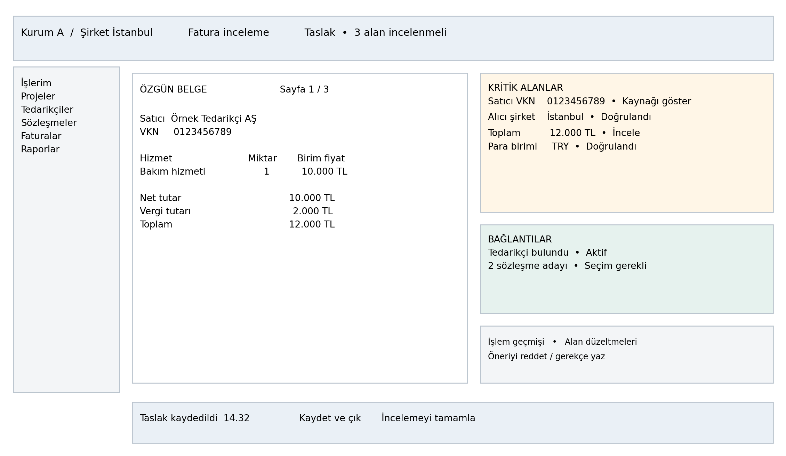
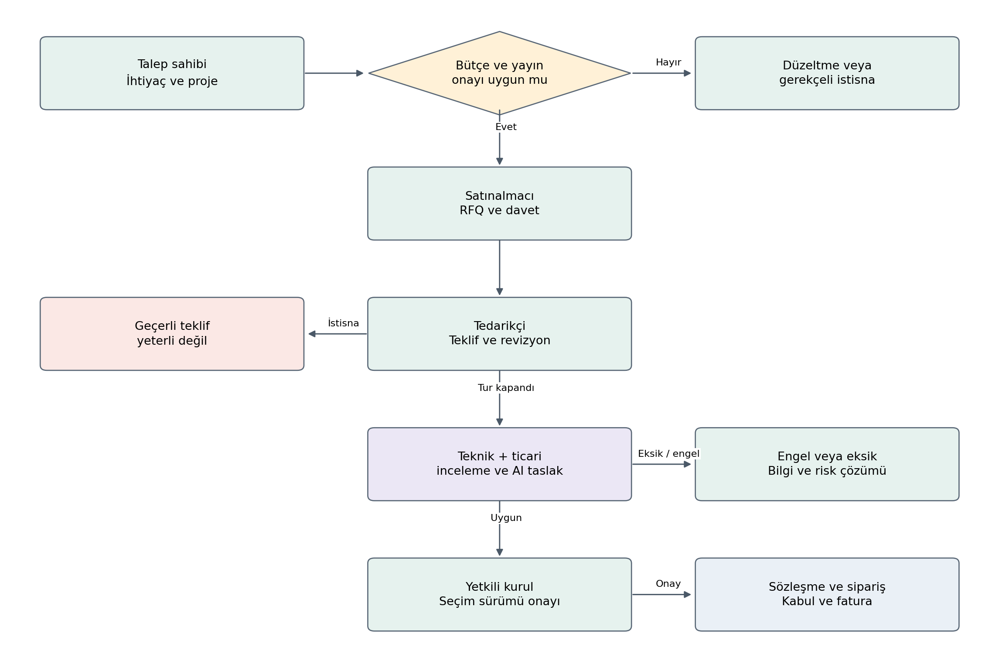
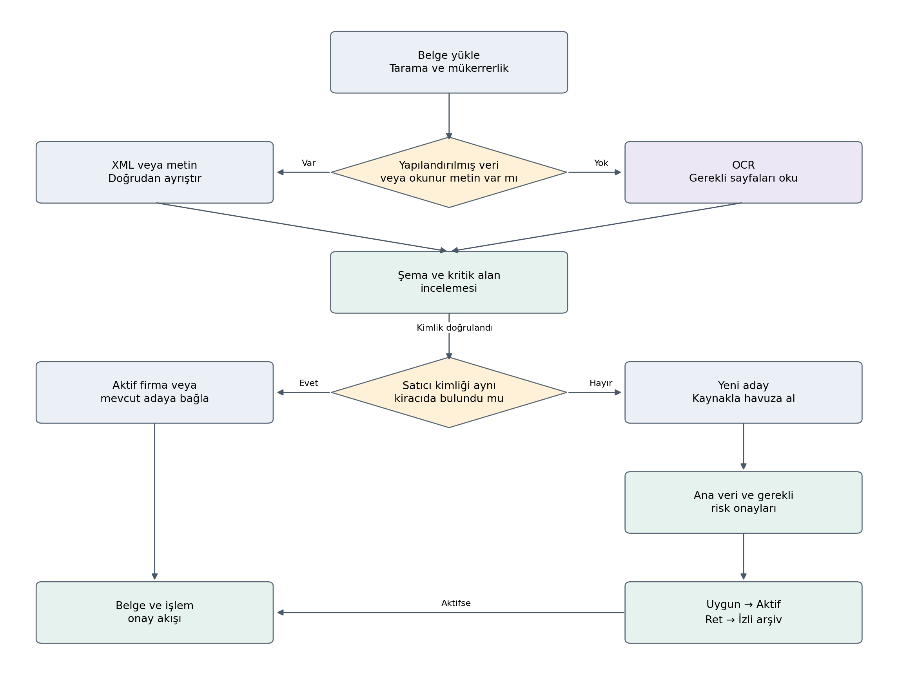
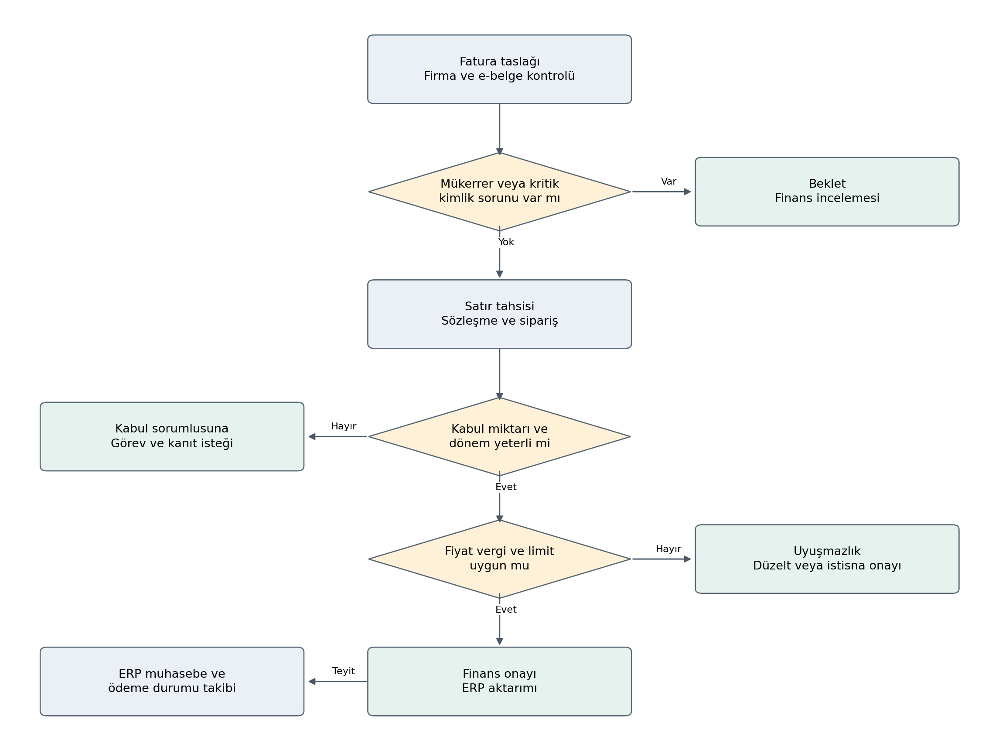
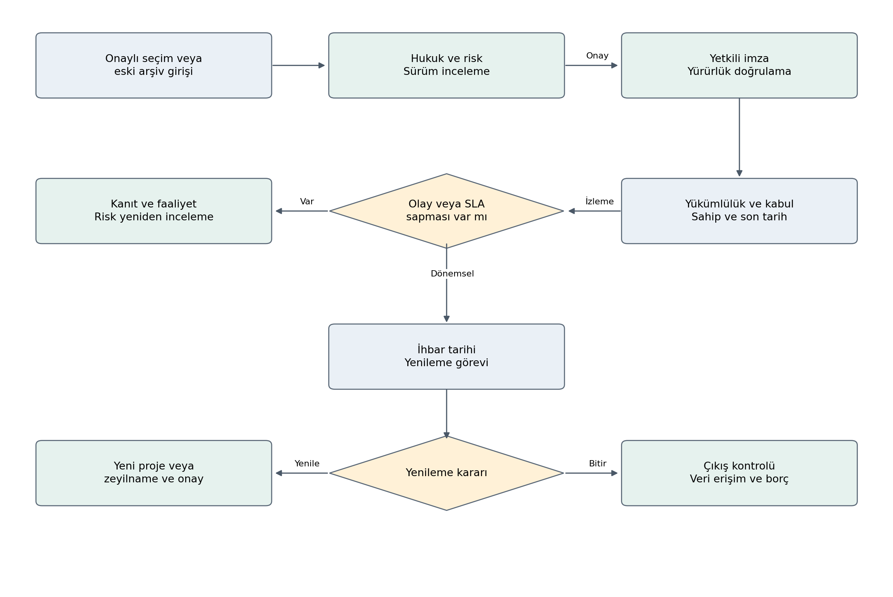
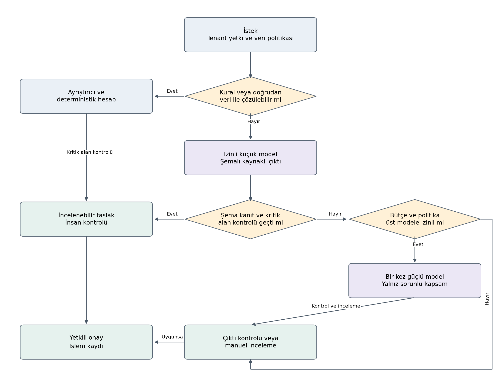
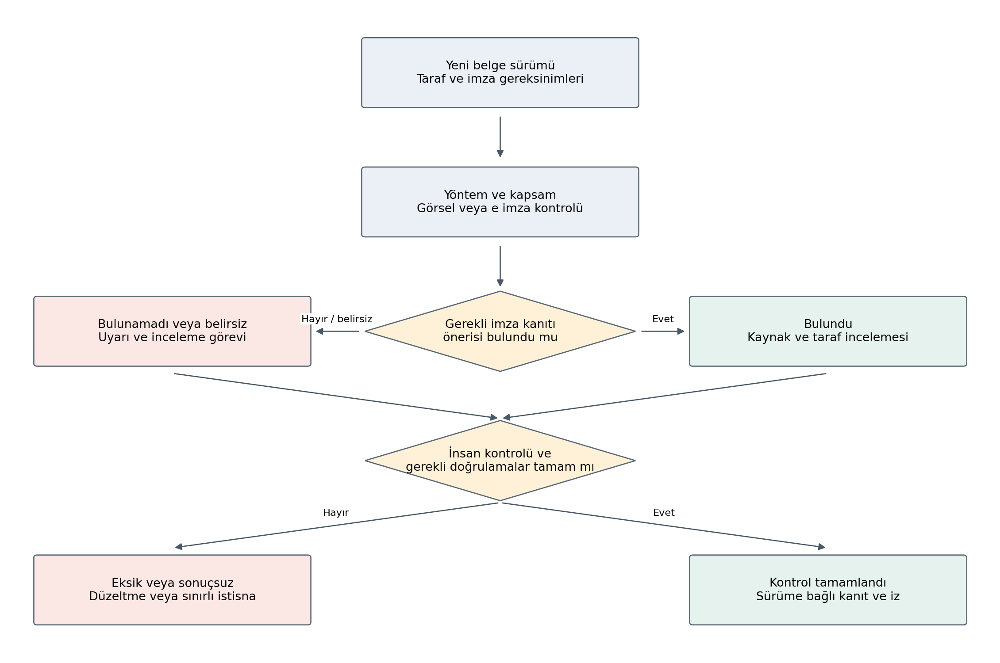

# Güncel satınalma ve sözleşme analizi
Sürüm 1.2 • 27 Ekim 2026
Bu dosya güncel Word analizinin bütün içerik aktarımıdır. İş gereksinimleri daraltılmamıştır.

# Satınalma ve sözleşme yönetimi uygulaması

## Yönetici özeti

Öneri, satınalma projelerini, teklifleri, tedarikçileri, sözleşmeleri ve faturaları tek bir işlem zincirinde birleştiren, web ve iOS üzerinden kullanılan çok kiracılı bir SaaS platformudur. Ürünün değeri belgeleri saklamaktan çok, hangi harcamanın hangi onaylı karara ve yükümlülüğe dayandığını kanıtlayabilmesidir.

### Ürün kararı

İlk ticari sürüm; proje bazında teklif toplama, kaynak gösteren AI karşılaştırması, onaylı tedarikçi kaydı, sözleşme ve yenileme takibi, OCR ile belge girişi, sipariş ve kabul kaydı üzerinden fatura kontrolünü kapsamalıdır. Tam muhasebe, banka ödeme yürütme ve kapsamlı ERP fonksiyonları entegrasyon alanı olarak tutulmalıdır.

### Kritik tasarım kararları
- AI alanları doldurur ve karşılaştırma taslağı üretir; kazananı, hukuki geçerliliği veya ödemeyi kesinleştirmez. Varsayılan ekonomik model, kontrollü üst modele geçiş ve insan kontrolü Bölüm 32–36’da tanımlıdır.
- Vergi kimliği mevcut tedarikçiyi aynı müşteri ortamında bulur. Bulunamayan firma aday havuzuna alınır; bağımsız onaydan önce aktif tedarikçi ve ödeme alıcısı olamaz.
- Teklif ve sözleşmenin faturaya bağlanması satır, miktar, dönem ve tutar düzeyinde yapılır. Kısmi teslimat, taksit, avans, iade ve birden çok proje desteklenir.
- Tedarikçi performansı ile güvenlik riski ayrı tutulur. Kritik bir güvenlik engeli, yüksek ticari puanla bertaraf edilemez.
- Kiracı izolasyonu veri tabanı, dosya, arama, AI bağlamı, kuyruk ve yedeklerde uygulanır. Bulut bölgesi ve AI veri akışı müşteri politikasıyla belirlenir.

### Pazar ve farklılaşma

SAP Ariba, Coupa ve Ivalua bütünleşik satınalma yaklaşımı; Icertis ve Ironclad sözleşme zekâsı; Promena ve PratisPro Türkiye pazarı için referans alınmıştır. Önerilen farklılaşma, Türkiye belge akışlarını kanıta dayalı AI karşılaştırması ve yıl boyu tedarikçi olay takibiyle sade bir deneyimde birleştirmektir. Bu bir ürün hipotezidir; rakiplerde bulunmadığı doğrulanmış bir özellik iddiası değildir. [K1–K8]

Uygulama kararı: 3–5 pilot kurumla süreç ve belge doğruluğunu doğrula. Bölüm 22–27 UI/UX, 28–32 grafik süreçler, 33–36 AI ve maliyet, 39–42 imza kontrolünü netleştirir. Belgedeki eksik imza taraf bazında işaretlenir; görüntü tespiti, insan kontrolü ve asıl belge takibi ayrılır. AI karar vermez; gerekli kontroller ve yetkili onayla işlem tamamlanır.

## 1 Amaç kapsam ve okuma rehberi

Bu belge, ürün sahibi, satınalma, finans, hukuk, bilgi güvenliği ve geliştirme ekibi için ortak karar temelidir. İlk araştırma tarihi 25 Ekim 2026, UI/UX ve AI güncellemesi 27 Ekim 2026’dır. İlk hedef pazar, Türkiye’de faaliyet gösteren özel sektör kuruluşları ve çok şirketli gruplardır. Kamu ihale mevzuatına tabi süreçler ilk kapsamın dışındadır.

İş modeli varsayımı: bağımsız kurumlara hizmet veren B2B SaaS. Bir kiracı bir müşteri organizasyonudur; aynı kiracı altında birden çok tüzel kişi, şube, departman ve maliyet merkezi bulunabilir. Kiracı, şirket ve proje sınırları birbirine eşit kabul edilmez. Türkçe ve İngilizce arayüz, TRY ve yabancı para işlemleri hedeflenir.

| Bölüm | Karar alanı |
| --- | --- |
| 2–3 | Pazar örnekleri ve ürün konumlandırması |
| 4–14 | Roller, proje, teklif, tedarikçi, OCR, sözleşme ve fatura |
| 15–21 | Deneyim temeli, mimari, güvenlik, entegrasyon ve yol haritası |
| 22–27 | UI/UX tasarımı, ekranlar, yolculuklar ve kabul kriterleri |
| 28–32 | Grafik süreçler ve AI yönlendirme |
| 33–36 | AI modelleri, kullanım alanları, maliyet ve kalite kapıları |
| 37–42 | Kaynaklar ve imza kontrolü gereksinimleri |

### Kapsama alınan uçtan uca zincir

İhtiyaç → proje ve bütçe kontrolü → RFQ/RFP → teklif turları → teknik ve ticari değerlendirme → seçim onayı → sözleşme → sipariş veya hizmet taahhüdü → teslimat ve hizmet kabulü → fatura eşleştirme → finans onayı → ERP aktarımı ve ödeme durumu → performans ve yenileme.

### Ürün sınırları
- Platform, gelen tedarikçi faturalarının yönetimi ve kontrolünü yürütür. Satış faturası düzenlemek ayrı bir modüldür ve başlangıç varsayımı değildir.
- Muhasebe fişi, yasal defter ve ödeme gerçekleşmesi için ERP/muhasebe sistemi kayıt otoritesidir. Platform operasyonel onay ve eşleştirme otoritesidir.
- İleri e-ihale optimizasyonu, stok/depo, bordro, doğrudan banka ödeme emri ve kamu ihale sistemi ilk sürümde yoktur.
- Sağlık veya finans gibi sektörlerde ilave veri yerleşimi ve tedarikçi kontrolleri ürün profiliyle eklenir; tüm müşterilere tek sektörün kuralları uygulanmaz.

### Gereksinimlerin yorumu

Takip eden kurallar önerilen ürün politikalarıdır. P0 ilk ticari sürüm için zorunlu, P1 sonraki genişleme, P2 ileri yetkinlik anlamındadır. Örnek puanlar ve süreler standartların zorunlu kıldığı sayılar değildir; pilot ve kurum politikasıyla kalibre edilmelidir.

## 2 Dünya örneklerinden alınacak dersler

Aşağıdaki seçim, kapsamla doğrudan ilişkili güçlü referanslardan oluşur; bağımsız bir pazar sıralaması değildir. Özellikler resmi ürün ve yardım sayfalarındaki açıklamalara dayanır. Paket, bölge ve lisans farkları satınalma demosunda doğrulanmalıdır.

| Ürün | Doğrulanan yaklaşım | Ürüne aktarılacak ders |
| --- | --- | --- |
| SAP Ariba [K1] | Sourcing, tedarikçi yaşam döngüsü, sözleşme ve faturalamanın ilişkili çalışması | Belge modülleri yerine ortak tedarikçi ve işlem bağlantıları kur |
| Coupa [K2] | AI fatura yüklemesinden sonra düzenlenebilir taslaklar ve uyumsuzluk görevleri | OCR sonucunu sessizce kesinleştirme; kullanıcıyı istisna iş listesine götür |
| Ivalua [K3] | Talep girişi, tedarikçi riski, sourcing ve sözleşmeyi birleştiren S2C | Talep girişini sadeleştir; tedarikçi riskini seçim sırasında görünür tut |
| Icertis [K4] | Yükümlülük, ödeme koşulu ve sözleşme kaynaklı mali risk görünürlüğü | İmzadan sonraki taahhütleri, ceza ve yenileme haklarını takip et |
| Ironclad [K5] | İş akışları, aranabilir depo, AI metadata ve sözleşme ailesi | Ana sözleşme ve ekleri versiyonlu bağla; incelemeyi belge bağlamında yap |

### Kopyalanmaması gereken yaklaşım

Kurumsal ürünlerin genişliğini ilk sürüme taşımak kurulumu, eğitimi ve geliştirmeyi uzatır. Başlangıçta tek bir kategori için eksiksiz uçtan uca akış, çok sayıda yarım modülden daha değerlidir. Tam görsel tasarım kalitesi hakkında yalnız pazarlama sayfalarından hüküm verilmemiştir; karşılaştırmalı görev testleri gerekir.

### Demo sırasında doğrulanacak sorular
- Tek faturanın satırları birden çok sözleşme veya projeye dağıtılabiliyor mu?
- Karşılaştırma raporundaki her hücre özgün teklifin ilgili sayfasına dönüyor mu?
- Sözleşme zeyilnamesi geçmiş fatura kontrollerini değiştirmeden ileri tarihli fiyat yaratabiliyor mu?
- Yeni tedarikçi ve banka bilgisi için bağımsız onay zorunlu kılınabiliyor mu?
- Kiracı bazında veri dışa aktarma ve geri yükleme hangi kapsamda sağlanıyor?

## 3 Türkiye örnekleri ve konumlandırma

| Referans | Resmi kaynakta görülen kapsam | Ürün açısından sonuç |
| --- | --- | --- |
| Promena [K6] | Tedarikçi ilişkileri, teklif ve ihale, e-satınalma ve sözleşme yönetimi | Türkiye’de bütünleşik satınalma beklentisi vardır; yalnız teklif toplamak yeterli farklılaşma sağlamaz |
| PratisPro [K7] | Alıcılar için RFQ ve e-ihale süreçleri; eski resmi materyallerde tedarikçi performansı ve ERP bağlantısı | Tedarikçi katılımı ve yerel iş akışları ürünün temelidir; eski materyaller güncel paket kapsamının kanıtı sayılmaz |

Bu ürünlerin “eksik” olduğu iddia edilmemektedir. Geliştirilecek ürünün avantajı, pilotlarda kanıtlanması gereken beş hipoteze dayanır: daha hızlı kurulum, daha az manuel veri girişi, açıklanabilir karşılaştırma, sözleşme ve fatura sapmalarının erken görülmesi, mobil onay ve saha kabulünün kolaylaşması.

### Önerilen ilk müşteri profili

Birden fazla lokasyonu, tekrarlayan hizmet sözleşmeleri ve dağınık PDF/Excel arşivi olan orta ve büyük kurumlar hedeflenmelidir. İlk pilot için BT hizmetleri, bakım veya tesis yönetimi gibi kapsamı ve kabul kriterleri tarif edilebilir bir kategori uygundur. Klinik ürün gibi özel düzenlemeli kategoriler ek uzmanlık doğrulamasıyla açılmalıdır.

### Yerel beklentiler
- VKN/TCKN, e-belge referansları, KDV/tevkifat alanları, Türkçe sözleşme tarihleri ve tutar biçimleri desteklenir. Kimlik bilgileri yetkiye göre maskelenir.
- Gelen e-Fatura için yapılandırılmış XML önceliklidir; yalnız PDF mevcutsa OCR kullanılır. Güncel GİB şema ve kod listeleri entegrasyon sırasında doğrulanır. [K13]
- ERP/muhasebe bağlantıları için ortak veri sözlüğü ve sertifikalı adaptör yaklaşımı kullanılır; her sağlayıcının açık ve yeterli API sunduğu varsayılmaz.
- Bulut hizmeti, OCR ve AI sağlayıcısının işleme bölgeleri ve alt işleyenleri sözleşmeyle görünür olmalıdır. Türkiye bölgesi seçimi yabancı destek erişimini kendiliğinden çözmez. [K12]

### Rekabet doğrulama planı

3–5 kurumda mevcut satınalma işinin gözlemi, en az iki farklı kategoriye ait anonimleştirilmiş belge seti ve rakip demo görevleri kullanılır. Teklif karşılaştırma süresi, düzeltme sayısı, izlenemeyen bağlantı oranı ve onay gecikmeleri başlangıç ölçümü olur. Fiyatlandırma araştırılmadan lisans bedeli veya tasarruf garantisi verilmez.

## 4 Roller yetkiler ve organizasyon

| Rol | Yapabildiği işlem | Sınır |
| --- | --- | --- |
| Talep sahibi | İhtiyaç, şartname, kabul ve olay girişi | Kendi alımını tek başına nihai onaylayamaz |
| Satınalmacı | Proje, RFQ, teklif normalleştirme, seçim önerisi | Tedarikçi veya ödeme onayını tek başına tamamlayamaz |
| Satınalma yöneticisi | Ticari karar, istisna ve kategori yönetimi | Limit ve görev ayrılığı politikalarına tabidir |
| Teknik değerlendirici | Atanmış kriterlere puan ve kanıt | Ticari teklifler politika gereği gizlenebilir |
| Hukuk | Madde inceleme, sözleşme sürümü, hukuki onay | Ödeme veya banka kaydı yetkisi doğmaz |
| Finans | Fatura, vergi, maliyet dağılımı ve ERP aktarımı | Mal/hizmet kabulünün yerine geçemez |
| Bilgi güvenliği | Risk değerlendirme, kanıt, bulgu, risk kabulü | Ticari sıralamayı gizlice değiştiremez |
| Ana veri sorumlusu | Aday firma, mükerrer birleştirme, banka doğrulama | Kendi açtığı kaydı tek başına aktifleştiremez |
| Tedarikçi | Davetli proje, kendi teklifi ve belge yanıtı | Rakip teklif veya kurum içi notları göremez |
| Kiracı yöneticisi | Kullanıcı, şirket ve politika ayarı | İşlem verisine otomatik sınırsız erişmez |
| Platform operasyonu | Sistem sağlığı ve yetkili destek | Müşteri belgesine varsayılan erişimi yoktur |
| Denetçi | Yetkili kapsamda salt okunur iz ve rapor | İş kayıtlarını değiştiremez |

Yetki modeli rol tabanlı temel üzerinde şirket, departman, kategori, proje üyeliği, belge hassasiyeti ve tutar gibi niteliklerle daraltılır. Bir kullanıcı birden çok kiracıya üye olabilir; her işlemde aktif kiracı açıkça görünür ve sunucu tarafından doğrulanır.

Vekâlet başlangıç ve bitiş tarihli, kapsam ve tutar limitli olmalıdır. Vekil de çıkar çatışması ve görev ayrılığı kontrolünden geçer. Yetki iptalinde açık oturum, indirme bağlantısı ve bekleyen görev erişimi yeniden değerlendirilir.

## 5 Satınalma projesi ve teklif toplama

### Proje kartı

Proje numarası, sahip, alıcı tüzel kişi, kategori, maliyet merkezi, ihtiyaç açıklaması, bütçe ve para birimi, planlanan tarihler, teslimat lokasyonu, değerlendirme heyeti, gizlilik düzeyi ve ilişkilendirilen talep zorunlu alanlardır. Lotlar, ürün/hizmet satırları, birim, miktar, teknik kriter ve kabul koşulu proje altında tutulur.

### İş akışı
- Taslak proje talep sahibince hazırlanır; kategori ve tutara göre bütçe, teknik ve satınalma kontrolüne gider. Bütçe kaynağı yoksa “bütçe doğrulanmadı” statüsü açıkça gösterilir.
- Satınalmacı RFQ/RFP şablonunu seçer. Teknik gereksinimler, zorunlu belgeler, fiyat tablosu, süreler ve değerlendirme ağırlıkları yayın öncesinde kilitlenir.
- Tedarikçiler kategori ve uygunluk durumuna göre seçilir. Aday firma bilgi ve teklif sunabilir; seçimin kesinleşmesi ve işlem yetkileri aktivasyona bağlıdır.
- Tedarikçi portalı tek kullanımlık davetin ardından doğrulanmış hesapla çalışır. Davet başka kişiye aktarılırsa organizasyon yetkisi tekrar doğrulanır.
- Teklif turu sonuna kadar rakip teklif gizliliği korunur. Kapalı teklif modu ile açılış yetkisi ve zamanı politika ile belirlenir.
- Soruların ticari sır içermeyen yanıtları ilgili tüm katılımcılara aynı içerikle dağıtılır. Şartname değişikliği sürüm ve gerekirse süre uzatımı yaratır.

| Durum | Çıkış koşulu |
| --- | --- |
| Taslak → Onayda | Şartname, sahip, bütçe ve kriterler tamam |
| Onayda → Teklife açık | Yetkili yayın onayı ve tedarikçi listesi |
| Teklife açık → Değerlendirmede | Son tarih veya yetkili erken kapanış gerekçesi |
| Değerlendirmede → Seçim onayında | Geçerli teklif seti ve inceleme kanıtı |
| Seçim onayında → Sözleşme aşamasında | Kazanan dağılımı ve karar sürümü onaylı |
| Uygulamada → Kapalı | Açık taahhüt, fatura ve yükümlülükler açıklanmış |

Tek kaynak, acil alım, iptal, sonuçsuz proje ve yeniden ihale için ayrı gerekçe ve onay akışı bulunur. “En az üç teklif” gibi kurallar kurumsal politikadır; evrensel zorunluluk olarak kodlanmaz. Süre uzatımı ve teklif revizyonu eski sürümleri silmez.

## 6 Teklif karşılaştırması ve seçim kararı

### Karşılaştırılabilir veri

Teklif satırları proje kalemlerine eşlenir. Paket, adet, ay, kullanıcı, lisans ve hizmet saati gibi birimler kontrollü dönüştürülür. Eşdeğer olmayan ürün, kapsam dışı hizmet veya eksik kalem aynıymış gibi fiyat sıralamasına katılmaz; “karşılaştırılamıyor” olarak işaretlenir. Alternatif teklifler ana teklifin ayrı senaryosudur.

Fiyat hesabı; miktar × net birim fiyat, indirim, nakliye, kurulum, bakım, yenileme, vergi ve diğer maliyetleri ayrı gösterir. İndirilebilir ve indirilemez vergiler kurum politikasıyla ele alınır. Döviz karşılaştırmasında kur kaynağı, tarih ve sabitlenen değer raporla saklanır; özgün para birimi korunur.

### Örnek değerlendirme yöntemi

Zorunlu uygunluk kapısından geçen teklifler için fiyat %40, teknik uygunluk %30, teslimat ve hizmet %15, doğrulanmış performans %15 ağırlığı önerilebilir. Bu oranlar standart değildir. Güvenlik, çıkar çatışması ve zorunlu belge engelleri ayrıca uygulanır; ortalamaya gömülmez. Ağırlıklar teklif açıldıktan sonra değişirse yeniden değerlendirme ve yetkili gerekçe gerekir.

Pozitif ve karşılaştırılabilir TCO için fiyat puanı = 100 × en düşük uygun TCO / teklifin TCO değeri. Sıfır/negatif tutar ve farklı kapsamda bu formül uygulanmaz. Teknik puan kanıtlı rubrikle verilir. Eşit puan için önceden tanımlı kural veya kurul kararı kullanılır. En ucuzdan farklı seçim gerekçelendirilir.

### AI tarafından hazırlanan dosya
- XLSX: özgün fiyatlar, normalleştirilmiş satırlar, kur ve vergi varsayımları, deterministik formüller, kapsam farkları ve puanlar.
- PDF veya karar özeti: adaylar, uygunluk, sapmalar, toplam maliyet, riskler, öneri ve insan onayları.
- Her alan için belge kimliği, sürüm, sayfa/hücre ve alıntı bağlantısı; bulunamayan bilgi “belirtilmemiş” olarak kalır.
- Hangi model, şablon, kural, veri seti ve sürümle üretildiği kaydedilir. Teklif değişirse rapor güncelliğini kaybeder ve yeniden üretilir.

Seçim proje, lot veya satır bazında birden çok tedarikçiye bölünebilir. Toplam tahsis, miktar ve bütçe kontrol edilir. AI önerisi karar değildir; yetkili kurul onaylı değerlendirme sürümünden kazananı belirler.

## 7 Tedarikçi ana verisi ve aday havuzu

### Kimlik ve eşleştirme

Firma kimliği kiracı + ülke + kimlik türü + normalleştirilmiş vergi kimliği bileşimiyle benzersizdir. Türkiye’de VKN ve uygun durumlarda TCKN desteklenir; baştaki sıfırlar korunur. Biçim veya kontrol basamağı doğrulaması firmanın gerçekliği, mükellefiyeti veya banka hesabı sahipliği kanıtı değildir.

Faturada satıcı ve alıcı ayrıştırılır; alıcı şirketin VKN’si tedarikçi diye eşlenmez. Sözleşmede taraf rolleri belirlenir. Çok taraflı sözleşme veya birden çok aday kimlik varsa kullanıcı seçmeden aktif kayıt yaratılmaz. Yabancı kimlikler ülkeye özgü kurala tabidir.

### Otomatik akış ve insan kontrolü
- Doğrulanabilir kimlik mevcut aktif firmayla tam eşleşirse belge taslağına bağlanır; belge ve işlem yine kendi onayından geçer. Ünvan farkı varsa sapma oluşturulur.
- Firma bulunamazsa OCR’dan gelen ünvan, kimlik, adres ve iletişim bilgileriyle aday kayıt otomatik açılır. Kaynak belge ve alan güveni saklanır.
- Aynı kimlikte bekleyen aday varsa yenisi açılmadan belgeler o adaya eklenir. Eşzamanlı yüklemelerde benzersizlik kısıtı ve atomik işlem kullanılır.
- Kimlik düşük güvenliyse aday taslağı oluşturulur fakat kesin kimlik anahtarı atanmaz; önce kimlik inceleme kuyruğuna gider. İsim benzerliği sadece öneridir.
- Ana veri sorumlusu belgeyi, firma kimliğini, kategori ve uygunluk gereksinimlerini inceler. Gerekli güvenlik ve finans onayları tamamlanınca firma aktifleşir.
- Aday reddedilirse belge ve ret gerekçesi korunur. Mükerrer birleştirmede eski kimliklerin yönlendirme ve denetim izi kalır.

| Durum | İzin |
| --- | --- |
| Aday / incelemede | Belge ve teklif toplanabilir; kesin seçim ve ödeme serbest bırakma engelli |
| Aktif / koşullu | Onaylı kategori ve koşullarla işlem; süresi dolan koşul yeniden inceleme açar |
| Askıda / engelli | Yeni taahhüt engelli; mevcut borç ve faturalar yetkili çözüm akışında |
| Pasif / arşiv | Yeni işlem yok; geçmiş ilişkiler ve yasal saklama korunur |

IBAN değişikliği ayrı kritik iş akışıdır. OCR mevcut banka verisini otomatik güncelleyemez; bağımsız doğrulama, ikinci onay ve kayıtlı güvenilir kanaldan teyit gerekir. Kiracılar arasında tedarikçi geçmişi veya olay verisi izinsiz paylaşılmaz.

## 8 Tedarikçi değerlendirmesi ve standartlar

Değerlendirme; başlangıç yeterliliği, hizmete özel risk, dönemsel performans ve olay sonrası yeniden inceleme olarak dört katmanda yapılır. Aynı firmanın temizlik hizmeti ve ayrıcalıklı BT erişimi için aynı anketi doldurması beklenmez. Sertifika tek başına olumlu karar değildir; kapsamı, geçerliliği ve hizmetle ilişkisi doğrulanır.

| Referans | Uygulamadaki karşılık | Toplanacak kanıt |
| --- | --- | --- |
| ISO 9001 dış sağlayıcı kontrolü [K9] | Seçim, izleme, yeniden değerlendirme ve düzeltici faaliyet | Kabul sonucu, uygunsuzluk, kalite ölçümü, denetim kaydı |
| ISO IEC 27001 ve 27002 [K10] | Tedarikçi güvenliği, anlaşma hükümleri, hizmet değişiklikleri ve bulut riski | BGYS kapsamı, erişim, olay, süreklilik ve sözleşme kontrolleri |
| ISO IEC 27036 2 [K10] | Tedarikçi ilişkisinin yaşam döngüsü boyunca güvenlik yönetimi | Sorumluluklar, gereksinimler, izleme, çıkış ve alt yüklenici kanıtı |
| NIST SP 800 161 Rev 1 [K11] | Özellikle BT tedarik zincirinde ürün ve hizmet risk analizi | Bağımlılık, yazılım bileşeni, güvenlik güncelleme ve tedarik zinciri kanıtı |
| KVKK ve aktarım çerçevesi [K12] | Kişisel veri rolü, veri akışı ve hukuki mekanizma kaydı | Veri işleme koşulları, alt işleyen listesi ve gerekli aktarım belgeleri |

### Anket tasarımı

Her soru; kontrol kimliği, sürüm, uygulanabilirlik, yanıt, kanıt, kanıt tarihi ve süresi, değerlendirici, bulgu, risk sahibi ve düzeltici faaliyet alanlarını taşır. “Uygulanamaz” yanıtı gerekçesiz kabul edilmez. Eksik yanıt başarılı sayılmaz; bilinmiyor olarak risk görünürlüğü yaratır. Standart metinleri lisanssız kopyalanmaz; kontrol eşlemesi yetkili uzmanla doğrulanır.

### Örnek güvenlik soru seti
- Hangi kişisel veya ticari veriler işleniyor; nerede tutuluyor ve hangi alt işleyenlere aktarılıyor?
- Uzak/ayrıcalıklı erişim nasıl onaylanıyor, MFA ve erişim sonlandırma nasıl uygulanıyor?
- Zafiyet, güvenli geliştirme ve kritik yama yönetimi için hangi kanıtlar mevcut?
- Olay bildirim süresi, iletişim sorumlusu ve tatbikat kayıtları sözleşmeyle belirli mi?
- Yedekleme, geri dönüş testi, iş sürekliliği ve hizmet bitiminde veri iadesi/silme kanıtı var mı?

Ürün standartlara dayalı değerlendirmeyi destekler; ISO sertifikası vermez ve otomatik uygunluk garantisi üretmez. Nihai standart sürümleri ve madde eşlemeleri uygulama başlangıcında resmi katalog ve lisanslı metin üzerinden teyit edilmelidir.

## 9 Risk puanı olaylar ve düzeltici faaliyet

### Performans ve riskin ayrılması

Performans puanı teslimat, kalite, SLA, iletişim ve ticari uyumu ölçer. İçsel risk; veri hassasiyeti, erişim seviyesi, hizmet kritiklik derecesi, ikame edilebilirlik ve alt yüklenici bağımlılığından oluşur. Artık risk, doğrulanmış kontrollerden sonra risk sahibinin kabul ettiği seviyedir. Belgesiz bir yüzde indirimiyle otomatik düşürülmez.

Örnek performans ağırlıkları: kalite %30, zamanında ve tam teslimat %25, SLA %20, iletişim %10, ticari uyum %15. Kategori bazında değişebilir. Ölçüm dönemi, teslimat sayısı ve veri kapsamı gösterilir. Bir teslimatı olan firma ile yüz teslimatı olan firma aynı güvenle sıralanmaz; yeterli veri yoksa puan yerine “yetersiz veri” gösterilir.

### Olay kaydı

Olay; ilgili tedarikçi, sözleşme/proje/sipariş, lokasyon, tarih, kategori, bildiren, doğrulayan, etki, kanıt ve sahip ile açılır. Kategoriler kalite kusuru, gecikme, kesinti, fatura ihtilafı, güvenlik, kişisel veri ve etik ihlal olabilir. İddia ile doğrulanmış bulgu ayrı statüdür. Ticari ihtilaf nedeniyle otomatik kesin suçlama oluşturulmaz.

| Aşama | Kontrol |
| --- | --- |
| Bildirim → Ön inceleme | Mükerrer olay kontrolü, gizlilik ve aciliyet |
| Doğrulama → Etki | Sorumluluk analizi; etki ve kök neden kanıtı |
| Faaliyet → Takip | Düzeltici faaliyet sahibi, hedef tarih ve hatırlatma |
| Doğrulama → Kapanış | Bağımsız kapanış kontrolü; kalıntı risk ve tekrar testi |
| İtiraz → Yeniden inceleme | Tedarikçi yanıtı ve değişmeyen önceki kayıt izi |

Puan etkisi yalnız doğrulanmış olaylara uygulanır. Aynı SLA ihlali hem metriğe hem ceza puanına eklenerek iki kez sayılmaz. Seviyeler ve dönemsel etkiler politika sürümüyle saklanır. Ciddi güvenlik olayı yeniden risk incelemesi ve gerekirse yeni işlem durdurma tetikler; sistem hukuki veya düzenleyici bildirimi kendiliğinden göndermez.

Yıllık tedarikçi karnesi, dönemler arası eğilim, açık faaliyetler, olay sayısı ve şiddeti, hizmet hacmine göre oranlar, geçerli kanıtlar ve değerlendiren kişileri gösterir. Yüksek riskli firmalar için yıllıktan daha sık, örneğin altı aylık gözden geçirme kurumca tanımlanabilir.

## 10 OCR belge işleme ve AI denetimi

### İşleme hattı

Yükleme → dosya türü ve boyut kontrolü → zararlı yazılım taraması ve karantina → hash ve mükerrerlik → belge sınıflandırma → varsa yapılandırılmış veri veya gömülü metin → gerekiyorsa OCR → şemaya uygun alan çıkarımı → deterministik doğrulama → tedarikçi ve işlem adayı eşleştirme → kullanıcı incelemesi → kayıt onayı.

| Belge | Otomatik doldurulacak başlıca alanlar |
| --- | --- |
| Fatura | Satıcı/alıcı kimliği, numara, ETTN, tarih, para birimi, satır, miktar, birim, vergi, toplam, vade ve referanslar |
| Sözleşme | Taraflar ve roller, başlık, tür, başlangıç/bitiş, bildirim süresi, bedel/limit, para birimi, ödeme koşulu, yenileme ve yükümlülükler |
| Teklif | Teklif sahibi, tarih ve geçerlilik, kalem, kapsam, miktar, fiyat, kur, teslimat, garanti, bakım ve istisnalar |
| Tedarikçi belgesi | Ünvan, vergi kimliği, adres, iletişim ve belge geçerliliği; banka bilgisi yalnız öneri |

### Alan düzeyinde güven ve doğrulama

Her alanın özgün metni, kaynak konumu, çıkarım yöntemi, model sürümü, inceleme durumu ve güven göstergesi saklanır. Modelin kendi söylediği güven tek başına yeterli değildir. Pilot etiketli veri setiyle kalibrasyon yapılır. VKN, toplam, para birimi, sözleşme tarafı ve tarih gibi kritik alanlar ilk sürümde insan onayından geçer.

Toplam ve vergi mutabakatı, tarih mantığı, taraf kontrolü ve sözleşme limiti kuralları AI dışında çalışır. Boş alan uydurulmaz. İmza görseli “imzalı olabilir” işareti yaratabilir; hukuki imza geçerliliği veya imzalayan yetkisi kanıtı sayılmaz. XML bulunması da tek başına belge geçerliliği kanıtı değildir. İmza görüntüsü tespiti OCR metin çıktısından bağımsız görsel kanıt gerektirir; bulunamadı sonucu kesin imzasızlık hükmü değildir.

### AI güvenliği ve operasyonu
- Belge içindeki talimatlar güvenilmeyen veri kabul edilir. Prompt injection, gizli metin ve bozuk PDF senaryoları test edilir. Model onay veya dış iletişim aracı kullanamaz.
- Müşteri verisi varsayılan olarak model eğitiminde kullanılmaz. Sağlayıcı saklama süresi, bölge, günlük ve alt işleyen politikaları doğrulanır.
- OCR/LLM işleri kuyrukta asenkron yürür; durum, tekrar deneme ve insan incelemesine geçiş görünürdür. Aynı iş yeniden çalışınca mükerrer kayıt yaratılmaz.
- Belge veya yetki değişirse arama indeksi ve AI erişimi de güncellenir. Düzeltmeler kiracılar arası veri sızdıran ortak eğitime otomatik aktarılmaz.

## 11 Sözleşme yaşam döngüsü

### Sözleşme kartı ve ilişkiler

Sözleşme numarası, alıcı şirket, taraflar, tedarikçi, sorumlu, kategori, proje ve kazanan teklif sürümü; başlangıç, imza, yürürlük, bitiş ve bildirim tarihleri; para birimi, bedel veya tavan, ödeme planı, fiyat revizyonu, garanti, SLA ve gizlilik bilgileri tutulur. Süresiz veya bedelsiz sözleşmeler uygun ayrı kuralla desteklenir.

Ana sözleşme, sipariş formu, iş tanımı, ek protokol ve zeyilnameler sözleşme ailesidir. Belge önceliği ve yürürlük tarihi hukuk tarafından belirlenir. Ana belgeye son yüklenen ekin her koşulu otomatik geçersiz kıldığı varsayılmaz. Eski fiyatlar ve onaylar geçmiş işlemler için korunur.

### İş akışı
- Talep veya arşivden aktarım → taslak → ticari/teknik inceleme → hukuk ve risk incelemesi → iç onay → imzaya gönderim → imza doğrulama → yürürlük → yenileme/fesih → kapanış ve arşiv.
- İmzalı eski sözleşme yüklemesi taslak yazım adımlarını atlayabilir; metadata ve yetkili kayıt kontrolünü atlayamaz. Kaynak “eski arşiv” olarak işaretlenir.
- Önemli bedel, taraf, süre ve yükümlülük değişikliği yeni sürüm ve uygun yeniden onay yaratır. Onay ekranı eski ve yeni değerleri gösterir.
- İç onay bir sözleşmenin hukuki imzası değildir. Her belge sürümünde taraf ve gerekli imzacı bazında imza kontrolü yapılır. İmza görüntüsü bulunamayan veya eksik belgeler işaretlenir, sorumluya görev açılır. Islak imza görüntüsü, asıl belgenin teslimi ve e-imza doğrulaması ayrı tutulur. Durum modeli ve kontroller Bölüm 39–42’de tanımlıdır.

### Yükümlülük ve finansal hak takibi

Her yükümlülüğün sahibi, karşı tarafı, teslim tarihi, sıklığı, kanıtı ve yerine getirme durumu vardır. Bakım ziyareti, güvenlik raporu, lisans adedi, hizmet kredisi veya eğitim gibi yükümlülükler görev üretir. SLA ihlalinin ceza veya kredi doğurması, ilgili madde ve insan doğrulamasına bağlıdır.

Yenileme uyarısı sadece bitiş tarihine göre değil, bildirim son gününe göre planlanır. Örnek: 31 Aralık bitiş ve 60 gün önce ihbar şartında, hukukça doğrulanmış hesaplama kuralı ile son ihbar tarihi bulunur; 90/60/30 günlük uyarılar bu tarihe göre düzenlenir. Tatil günü ve süre yorumları sözleşmeye göre doğrulanır.

Sözleşmenin bitmesi veri, erişim ve borç ilişkisini kendiliğinden kapatmaz. Çıkış kontrolü; veri iadesi/silme, hesap kapatma, teminat iadesi, açık fatura ve kalan yükümlülükleri içerir. Yenileme, yeni satınalma projesi tetikleyebilir.

## 12 Fatura sipariş ve kabul eşleştirmesi

Yalnız sözleşmeyle aynı toplamı taşıyan faturayı doğru saymak yeterli değildir. Mal alımında sipariş–kabul–fatura üçlü kontrolü; hizmette sözleşme/sipariş–dönem veya kilometre taşı kabulü–fatura kontrolü önerilir. Tam depo modülü yerine hafif sipariş ve kabul kaydı veya ERP entegrasyonu yeterlidir.

### Eşleştirme hiyerarşisi
- Alıcı tüzel kişi ve satıcı kimliği doğrulanır. ETTN, fatura numarası ve hash üzerinden mükerrerlik kontrol edilir.
- Özgün sipariş/sözleşme referansı aranır; yoksa tedarikçi, geçerli tarih, para birimi, kalem ve dönemle adaylar sıralanır. VKN eşleşmesi tek başına sözleşme seçmez.
- Fatura satırı sipariş ve sözleşme satırına miktar, birim fiyat, birim, vergi, dönem ve para birimiyle bağlanır. Kabul edilen miktar ve önceki fatura tüketimi kontrol edilir.
- Tam ve tek anlamlı eşleşme önerilir; belirsiz veya çoklu eşleşme istisna kuyruğuna gider. İlk sürümde kritik bağlantı insan tarafından doğrulanır.
- Onay, ERP kaydı ve ödeme durumu ayrı izlenir. API başarılı yanıtı para ödendi anlamına gelmez.

| Senaryo | Beklenen davranış |
| --- | --- |
| Kısmi teslimat | Yalnız kabul edilen ve daha önce tüketilmemiş miktar eşleşir |
| Taksit veya dönemsel hizmet | Aynı dönem/taahhüt iki kez faturalanamaz; plan ve kabul kontrolü |
| Avans | Ayrı onay ve teminat politikası; sonraki faturada mahsup izlenir |
| İade veya alacak belgesi | Özgün faturaya bağlanır; net tüketim ters kayıtla düzeltilir |
| Tek faturada çok proje | Satır veya tutar tahsisi toplamı özgün faturayla eşit olmalıdır |
| Sözleşmesiz fatura | Ayrı istisna ve yetkili gerekçe; geriye dönük onaylıymış gibi gösterilmez |
| Uyuşmazlık veya iptal | Hukuki e-belge durumu ile kurum içi iş durumu ayrı tutulur |

Tolerans; tutar, yüzde, para birimi ve kategori bazında tanımlanır. Örnek %1 veya 100 TL eşiklerinin hangisinin geçerli olduğu açık kuraldır; varsayılan evrensel tolerans yoktur. Kritik kimlik ve para birimi uyuşmazlığı toleransa girmez. Ödeme vadesi ve ihtilaf görevleri takip edilir; banka ödeme yürütme ilk kapsam dışıdır.

## 13 Kontroller ve onay kuralları

| Kural | Zorunlu davranış | Öncelik |
| --- | --- | --- |
| BR01 Kiracı sınırı | İşlem, dosya ve rapor yalnız yetkili kiracıda çalışır | P0 |
| BR02 Aday firma | Aktivasyon öncesi kesin kazanan ve ödeme serbest bırakma engeli | P0 |
| BR03 Görev ayrılığı | İşi başlatan tek başına son onaylayıcı olamaz | P0 |
| BR04 Sürüm | Onay belirli belge ve veri sürümüne bağlanır | P0 |
| BR05 Veri değişimi | Bedel, banka, taraf, süre değişimi uygun yeniden onayı tetikler | P0 |
| BR06 Teklif gizliliği | Son tarih ve açılış yetkisi sunucuda uygulanır | P0 |
| BR07 Limit kontrolü | Bütçe ve sözleşme kullanımında eşzamanlı tüketim aşımı engellenir | P0 |
| BR08 Mükerrerlik | Aynı belge veya iş tekrarı ikinci borç/taahhüt yaratmaz | P0 |
| BR09 AI yetkisi | AI çıktısı taslaktır; nihai onay veya ödeme üretemez | P0 |
| BR10 İstisna | İhlal yetki, gerekçe, kapsam, süre ve denetim izi gerektirir | P0 |
| BR11 Geri alma | Tamamlanan iş sessiz silinmez; iptal veya ters işlem kullanılır | P0 |
| BR12 Bildirim | Hatırlatma ve eskalasyon tekrarlı çalışsa da tek işlem yaratır | P0 |

### Onay motoru

Tüzel kişi, kategori, tutar, para birimi, risk, sözleşme türü ve bütçe durumuna göre paralel veya ardışık adımlar üretilir. Motor; kimin, hangi veriyle, hangi politika sürümünde onaylaması gerektiğini açıklayabilmelidir. Yayın öncesi senaryo simülasyonu ve değişiklik onayı bulunur. Devam eden işler eski veya yeni kurala açık bir göç kararıyla bağlanır.

### Limit ve taahhüt hesabı

Kullanılabilir sözleşme limiti = onaylı tavan − net tüketim − henüz tüketilmemiş açık taahhüt. Örnek: 1.000.000 TL tavan, 400.000 TL faturalanmış tüketim ve kalan 300.000 TL açık sipariş için kullanılabilir tutar 300.000 TL’dir. Toplam siparişin faturalanmış bölümü tekrar açık taahhüt sayılmaz. İade ve iptal yalnız doğrulanmış ters işlemle limiti etkiler.

Limit hesaplamasının vergi dahil/haric ve döviz yöntemi sözleşme bazında tanımlanır. Yeniden deneme veya aynı anda iki onay limiti aşamamalıdır; uygulama ekranındaki uyarı yerine veri tabanında atomik kontrol gerekir.

## 14 Temel veri modeli ve izlenebilirlik

| Varlık | Önemli alan ve ilişki |
| --- | --- |
| Tenant ve LegalEntity | Kiracı politikası, bölge; altında alıcı şirketler ve maliyet merkezleri |
| Supplier ve SupplierCandidate | Vergi kimliği; aday onay geçmişi; şirket bazlı kullanım ve banka kayıtları |
| Project ve ProjectLine | İhtiyaç, bütçe, kategori; lot, miktar ve teknik gereksinim |
| RFx ve BidVersion | Tur, kapanış; tedarikçi ve değişmeyen teklif sürümü |
| Evaluation ve AwardLine | Kriter sürümü, kanıt, puan; kazanan ve miktar dağılımı |
| Contract ve Amendment | Sözleşme ailesi, yürürlük; madde, fiyat ve limit sürümleri |
| Obligation ve Milestone | Sahip, zaman, kabul koşulu, SLA ve kanıt |
| PurchaseOrder ve Receipt | Sipariş satırı; mal/hizmet kabulü ve ters kabul |
| Invoice ve InvoiceLine | Özgün belge, vergi, satırlar, iş ve yasal durum |
| Allocation ve MatchResult | Fatura satırından proje/sipariş/sözleşmeye tutar ve miktar tahsisi |
| Assessment ve Incident | Anket sürümü, risk, dönem; olay, kök neden ve düzeltici faaliyet |
| Document ve ExtractedField | Hash, sürüm, sayfa; çıkarım, güven ve inceleme izi |
| Approval ve AuditEvent | Karar sürümü, aktör, zaman, önce/sonra ve gerekçe |

Bir proje birçok teklif alır; seçimin birden çok kazanan satırı olabilir. Sözleşme birden fazla proje veya siparişi kapsayabilir. Bir faturanın birden çok bağlantısı ve aynı sözleşmenin birçok faturası olabilir. Bu ilişkiler tek bir “contract_id” alanına sıkıştırılmaz; tahsis tablosunda izlenir.

### Tutarlılık kuralları

Tüm kiracı verileri zorunlu kiracı sahipliği taşır; şirketler arası referanslar yetkiyle doğrulanır. Tutarlar ondalık türde, özgün para birimiyle saklanır. Yuvarlama kuralları belge ve para birimine göre tutarlıdır. Tarih, saat dilimi ve yerel takvim hesapları ayrılır. Kaynak belge değişmez; OCR düzeltmesi ayrı veri sürümüdür.

Dış sistem kimliği, entegrasyon sürümü, korelasyon kimliği ve idempotency anahtarı tutulur. Geçmiş kararlara sonradan yeni model sonucu veya değişen puan yazılmaz. Denetim raporu belirli andaki belge, kur ve politika sürümünü yeniden kurabilmelidir.

## 15 Web ve iOS kullanıcı deneyimi

### Bilgi mimarisi

Ana navigasyon: İşlerim, Satınalma Projeleri, Tedarikçiler, Sözleşmeler, Faturalar ve Raporlar. Ayarlar ve profil ikincil menüdedir. İlk ekran rolün bekleyen işlerini, gecikmeleri ve kritik tarihleri gösterir; çok sayıda gösterişli fakat eylemsiz kartla doldurulmaz. Arama belge türü, şirket, tedarikçi ve dönemle daraltılabilir.

Proje çalışma alanında özet, kalemler, teklifler, karşılaştırma, karar, sözleşmeler, sipariş/kabul ve faturalar sekmeleri bulunur. Her ekranda durum, sorumlu ve bir sonraki adım görünür. Tedarikçi sayfası kimlik, uygunluk, performans, sözleşme ve olay geçmişini ortak zaman çizgisinde ilişkilendirir.

### Üç kritik ekran
- Belge inceleme: solda kaynak belge, sağda çıkarılan alanlar. Alan seçildiğinde sayfadaki kaynak vurgulanır; düşük güven ve tutarsızlık ayrı işaretlenir. Kullanıcı tek tek onay yerine yalnız gerekli alanları düzeltir.
- Teklif karşılaştırma: sabit satır başlıkları, yatay karşılaştırma, kapsam ve fiyat görünümü; eksik bilgi, alternatif ürün ve hariç tutulan maliyet açıkça gösterilir. Detay yan panelde açılır.
- Fatura kontrolü: fatura, sözleşme/sipariş ve kabul yan yana özetlenir. “Neden eşleşmedi” açıklaması, fark ve çözebilecek sorumlu tek ekrandadır.

| Web | iOS |
| --- | --- |
| RFQ tasarımı, yoğun karşılaştırma ve yönetim ayarları | Kamera ile tarama, belge yakalama ve yükleme |
| Sözleşme inceleme, toplu veri ve rapor | Kaynak belgeyi görerek onay veya gerekçeli ret |
| Kural, anket ve entegrasyon yönetimi | Sahada mal/hizmet kabulü, fotoğraf ve olay bildirimi |
| Tam operasyonel kayıt erişimi | Tedarikçi ve sözleşme sorgulama, kritik tarih ve görevler |

iOS, web ekranlarının küçültülmüş kopyası olmaz. Onayda tutar, para birimi, tedarikçi, sapma ve kaynak kanıt görünür. Bildirimden açılan işlem güncel yetkiyle yeniden doğrulanır. Çevrimdışı yalnız şifreli yakalama taslağı; nihai onay ve kabul sunucudan güncel durum alınarak tamamlanır.

Tasarım hedefi WCAG 2.2 AA ve iOS erişilebilirlik özellikleridir. Renk tek anlam taşıyıcısı olamaz; klavye, ekran okuyucu, Dynamic Type, boş/hata/yükleniyor durumları test edilir. 5–8 hedef kullanıcıyla ilk testte projenin açılması, OCR düzeltme, karşılaştırma ve onay görevleri ölçülür. Ekran davranışları, ölçüler ve kullanılabilirlik kabul kriterleri Bölüm 22–27’de; süreçlerin görsel karşılığı Bölüm 28–32’de ayrıntılandırılmıştır.

## 16 Çok kiracılı bulut mimarisi

### Önerilen başlangıç mimarisi

Web istemci ve SwiftUI iOS uygulaması ortak sürümlü API kullanır. API katmanında kimlik, yetki, tenant ve politika doğrulanır. İş alanları modüler monolit içinde ayrılır; OCR/AI, belge dönüştürme ve entegrasyon çalışanları ayrı kuyruklarla ölçeklenir. İlk aşamada dağıtık mikroservis sayısını artırmak yerine işlem tutarlılığı ve işletilebilirlik korunur.

İlişkisel veri için yönetilen PostgreSQL, değişmez belgeler için nesne deposu, asenkron işler için kuyruk, gerekiyorsa kiracı filtreli arama ve vektör indeksi; anahtar yönetimi, sır deposu, gözlemleme, WAF ve kimlik sağlayıcı kullanılır. Teknoloji adı zorunlu ürün bağımlılığı değildir; yönetilen hizmetlerin bölge ve veri işleme özellikleri seçimde doğrulanır.

### İzolasyon seçenekleri

| Model | Kullanım | Risk ve kontrol |
| --- | --- | --- |
| Paylaşımlı DB ve satır izolasyonu | Standart paket ve maliyet verimliliği | RLS, uygulama yetkisi, bileşik anahtar ve tenant negatif testleri |
| Ayrı veri tabanı veya dağıtım | Yüksek hassasiyetli kurumsal paket | Daha yüksek işletim maliyeti; ayrı anahtar ve yedek politikası |
| Bölgesel veri hücreleri | Yerleşim veya ölçek gereksinimi | Kiracı bölgeye sabitlenir; hücreler arası veri akışı sınırlanır |

Başlangıç önerisi, paylaşımlı altyapıda güçlü izolasyon; kurumsal müşteriler için ayrı veri tabanına geçiş yoludur. “Multi tenant” olmak tüm müşterilerin aynı veri tabanında olmasını zorunlu kılmaz. Kiracı kimliği istemciden gelen header’a güvenilerek alınmaz; doğrulanmış üyelikten türetilir. [K16]

### Arka plan işlerinde izolasyon

Dosya yolları, signed URL yetkilendirmesi, cache anahtarları, rapor çıktıları, bildirimler, vektör sonuçları ve kuyruk mesajları kiracı kapsamındadır. Mesaj üreticisi ve tüketicisi yetkili olmalıdır; yalnız mesajdaki tenant_id yetki kanıtı değildir. Her kiracı için OCR sayfası, token, depolama ve eşzamanlı iş kotası tanımlanır.

Geliştirme, test ve üretim ortamları ayrılır. Üretim belgesi test ortamına taşınmaz; anonim örnekler kullanılır. Altyapı kodla, sürümler kontrollü göçlerle yönetilir. Tek kiracı geri yüklemesi için canlı paylaşımlı veri tabanını eski yedeğe döndürmek yerine izole kurtarma ve seçici aktarım uygulanır.

## 17 Bilgi güvenliği ve veri koruma

| Alan | Asgari tasarım gereksinimi |
| --- | --- |
| Kimlik | Kurumsal OIDC/SAML, MFA; kritik işlemde yeniden doğrulama; kısa ömürlü erişim |
| Yetkilendirme | Sunucuda varsayılan ret; nesne ve alan düzeyinde kontrol; tenant ve şirket sınırı |
| Şifreleme | İletimde TLS, depoda yönetilen anahtar; sırların güvenli kasada tutulması |
| Belge güvenliği | Tarama/karantina, yetkili kısa süreli erişim, güvenli önizleme ve indirme izi |
| Denetim | Kim, neyi, ne zaman, hangi kiracı ve sürümde değiştirdi; hassas içerik loglanmaz |
| Destek erişimi | Süreli, gerekçeli ve onaylı erişim; ayrı yönetim yolu ve müşteri görünürlüğü |
| Uygulama güvenliği | Tehdit modelleme, bağımlılık/SAST/DAST, sır tarama ve bağımsız sızma testi |
| iOS | Keychain, şifreli önbellek, oturum iptali, bildirimlerde hassas içerik olmaması |
| AI | Yetki filtreli bağlam, veri minimizasyonu, injection testleri ve model sürüm takibi |
| Süreklilik | Şifreli ve değiştirilemez yedek, geri dönüş tatbikatı, olay müdahale planı |

Web/API güvenlik doğrulaması için OWASP ASVS 5.0.0, mobil için OWASP MASVS esas alınmalıdır. Uygulanabilir kontrol listesi ve kanıtları yayın kapısına bağlanır. Güvenlik iddiası yalnız bir tarama sonucuna veya “ISO uyumlu” ifadesine dayandırılmaz. [K14–K15]

### KVKK ve bulut veri akışı

Kurum, SaaS işletmecisi ve alt işleyenlerin veri sorumlusu/veri işleyen rolleri işlem bazında belirlenir. VKN’nin tüzel kişi kimliği olması tüm belgeleri kişisel veri kapsamından çıkarmaz; TCKN, imza ve iletişim bilgileri kişisel veri içerebilir. Amaç, erişim, saklama ve ilgili kişi süreçleri veri envanteriyle yönetilir.

Veri yerleşimi, OCR/AI çağrısı, telemetri, destek ve felaket kurtarma birlikte incelenir. Türkiye’de tutulan ana verinin yabancı bir AI hizmetine gönderilmesi ayrıca değerlendirilir. Yurt dışı aktarımı için geçerli hukuki mekanizma hukukça belirlenir; standart sözleşme seçenekleri ve yükümlülükleri güncel KVKK kaynaklarından doğrulanır. [K12]

Saklama süresi belge türü, sözleşme, hukuk ve mevzuata göre politika olur; tek bir evrensel süre sabitlenmez. Hukuki saklama talebi silmeyi durdurur. Müşteri çıkışında veriler, belgeler ve denetim izi anlaşılır biçimde dışa aktarılır; yedeklerin zaman içinde silinmesi ayrıca belgelenir. Uygulama onayı, e-imza ve yasal e-belge kabul/ret işlemleri birbirinden ayrılır.

## 18 Entegrasyonlar ve kayıt otoritesi

| Sistem | Platforma gelen | Platformdan giden |
| --- | --- | --- |
| ERP ve muhasebe | Firma kodu, bütçe, sipariş/kabul, muhasebe ve ödeme durumu | Onaylı firma talebi, fatura ve maliyet dağılımı, kontrollü sipariş |
| e-Belge özel entegratörü | XML, görsel, ETTN ve doğrulanmış durumlar | Yetkili ve desteklenen belge işlemleri; durum sorgusu |
| Kimlik sağlayıcı | Kullanıcı, grup, üyelik ve oturum politikası | Yetkili oturum ve denetim olayı |
| E-imza ve sözleşme editörü | İmza tamamlanma kanıtı, güncel belge | İmzaya gönderilecek sabit sürüm |
| E-posta ve bildirim | Proje/tenant kimlikli gelen evrak | Görev ve uyarı; hassas içerik yerine güvenli bağlantı |
| Raporlama | İsteğe göre dış veri ve kur kaynağı | Yetki filtreli rapor, API veya veri ambarı akışı |

Türkiye için Logo, Mikro, Netsis, Paraşüt; kurumsal müşteriler için SAP, Oracle ve Microsoft Dynamics aday bağlantılardır. Bunlar hazır ve doğrulanmış entegrasyon taahhüdü değildir. İlk pilotun kullandığı bir ERP ve bir e-belge entegratörü için API, yetkilendirme, lisans, maliyet ve test ortamı keşfi yapılmalıdır.

### İşlem güvenilirliği

Her entegrasyon olayı benzersiz iş anahtarı ve korelasyon kimliği taşır. Outbox, idempotent tüketici, sınırlı tekrar deneme, hatalı mesaj kuyruğu ve yetkili yeniden işleme kullanılır. Zaman aşımı “başarısız ve tekrar oluştur” sayılmaz; önce dış sistemde işlemin oluşup oluşmadığı sorgulanır.

ERP’ye aktarıldı, ERP’de muhasebeleşti, ödemeye uygun ve ödendi durumları ayrıdır. ERP firma kodu eşleştirmesi tek yönlü kontrolsüz üzerine yazma yapmaz. Hangi sistemin hangi alanın sahibi olduğu veri sözlüğünde tanımlanır. Günlük mutabakat; eksik, mükerrer ve tutarsız kaydı iş listesine çıkarır.

### İlk sürüm için bağlantı sınırı

Başlangıçta entegrasyon yoksa şeması tanımlı CSV/XLSX içe ve dışa aktarma sağlanabilir. Dosya değişimi de kayıt sayısı, toplam tutar, kimlik, hata raporu ve tekrar yükleme kontrolüyle yönetilir. Sessiz veri kaybına izin verilmez. E-posta ekleri gönderene güvenilerek doğrudan onaylı kayıt yaratmaz; normal tarama ve inceleme hattından geçer.

## 19 Raporlama hizmet hedefleri ve maliyet

### Yönetim göstergeleri

| Gösterge | Tanım ve ölçüm |
| --- | --- |
| Satınalma çevrim süresi | Onaylı ihtiyaçtan seçim onayına; bekleme ve aktif çalışma ayrı |
| Teklif karşılaştırma süresi | Geçerli teklifler hazır olduktan onaylı rapora kadar |
| Sözleşme kapsamı | Kapsama tabi onaylı harcamanın geçerli sözleşmeye bağlı oranı |
| Fatura istisna oranı | Kontrole giren faturada en az bir açık uyumsuzluk oranı |
| Yenileme disiplini | Bildirim son gününden önce sonuçlanan yenileme kararları |
| Tedarikçi performansı | Zamanında/tam teslimat, doğrulanmış SLA ve açık faaliyetler |
| OCR düzeltme oranı | İnsan incelemesinde değiştirilen alan / incelenen alan |
| Otomasyon güvenilirliği | Doğru otomatik öneri / incelenen otomatik öneri; belge türüne göre |
| Tasarruf | Önceden onaylı karşılaştırılabilir baz ile gerçekleşen maliyet farkı |

Tasarruf en pahalı teklif ile kazananın farkı olarak tek başına raporlanmaz. Bütçe, önceki karşılaştırılabilir fiyat veya piyasa bazının hangisinin kullanıldığı; miktar, kur ve kapsam düzeltmeleri açıkça gösterilir. Yönetim raporları ile fatura/ERP toplamları düzenli mutabık olmalıdır.

### Önerilen hizmet hedefleri

Pilot kapasite varsayımı: 50 kiracı, toplam 2.000 kayıtlı kullanıcı, 300 eşzamanlı kullanıcı ve ayda 100.000 belge sayfası. Bunlar talep tahmini değil yük testi girdisidir. Etkileşimli standart API işlemleri için p95 ≤ 2 saniye; büyük rapor ve OCR asenkron olmalıdır. İlk üretim hedefi aylık %99,9 erişilebilirlik; ana işlem verisinde RPO ≤ 15 dakika ve RTO ≤ 4 saat olarak önerilir. Bölge ve maliyet doğrulanmadan SLA taahhüdüne çevrilmez.

OCR kuyruk süresi, sayfa başı işleme süresi, doğrulama gecikmesi, hata ve tekrar oranı ayrı izlenir. Belge biçimi ve yoğunluğa göre SLA sınıfları tanımlanır. Kritik işlerin kuyruk önceliği ve kiracı başına adil kapasite sınırı vardır.

### Maliyet modeli

Aylık maliyet; veri tabanı, uygulama/çalışanlar, arama, depolama/yedek, güvenlik/gözlemleme, trafik ve OCR/LLM kullanımı toplamıdır. AI maliyeti sayfa × OCR birim bedeli + giriş/çıkış tokenı × model bedeli ile izlenir. Fiyat verilmeden önce gerçek belge örneklerinde tüketim ölçülmelidir. Paketleme kiracı/aktif kullanıcı tabanı ve dahil belge/AI kotasıyla yapılabilir; tüketim uyarıları ve harcama tavanı bulunmalıdır. Güncel model fiyat karşılaştırması ve hacim bazlı hesap Bölüm 33–35’te yer alır.

## 20 Fonksiyonel kapsam ve kabul ölçütleri

| Kimlik | Gereksinim | Doğrulanabilir kabul ölçütü |
| --- | --- | --- |
| FR01 | Proje ve lot açma | Sahip, şirket, bütçe ve kalemleri eksik proje yayınlanamaz |
| FR02 | Teklif turu ve portal | Tedarikçi yalnız kendi yetkili teklifini görür; tur geçmişi korunur |
| FR03 | Karşılaştırma dosyası | Her fiyat kaynağa döner; kur, birim ve eksik kapsam görünür |
| FR04 | Kazanan seçimi | Tek veya bölünmüş seçim onaylı rapor sürümüne dayanır |
| FR05 | Aday havuzu | Bilinmeyen VKN tek aday açar; aktivasyon bağımsız onaylıdır |
| FR06 | Firma eşleme | Alıcı VKN’si satıcı diye seçilemez; belirsiz taraf incelemeye gider |
| FR07 | OCR düzeltme | Kritik alan kaynağı ve önce/sonra değeri izlenir |
| FR08 | Sözleşme sürümü | Zeyilname ileri fiyatı değiştirir; geçmiş fatura kontrolü korunur |
| FR09 | Yenileme | İhbar son günü bazlı görev ve eskalasyon oluşur |
| FR10 | Fatura eşleştirme | Kısmi kabul ve önceki tüketim kalan limiti doğru hesaplar |
| FR11 | Olay ve faaliyet | Doğrulanmış olay, itiraz ve kapanış kanıtı raporlanır |
| FR12 | Tedarikçi risk değerlendirme | Kritik engel yüksek performans puanıyla geçilemez |
| FR13 | Web ve iOS | Aynı yetkiyle aynı karar; eski veri sürümünde onay engellenir |
| FR14 | ERP ve belge tekrarları | Aynı olay beş kez işlense de tek mali kayıt oluşur |
| FR15 | Kiracı yaşam döngüsü | Kurulum, kota, ihracat, kapatma ve saklama politikası işler |

### Güvenlik ve veri için yayın kapıları

Kiracı izolasyon testleri veri tabanı, API, dosya, arama, AI, rapor, kuyruk ve yedek kurtarmayı kapsar. Kritik veya yüksek etkili açıklar giderilmeden yayın yapılmaz. Görev ayrılığı, IBAN değişikliği, e-belge durumu, bağlantı tahsisi ve eşzamanlı limit testleri zorunludur. Bağımsız sızma testi ve geri yükleme tatbikatı tamamlanmalıdır.

OCR için farklı tarama kaliteleri, Türkçe karakterler, tablo yapıları ve yabancı para içeren en az 300 anonimleştirilmiş belgeyle başlangıç değerlendirmesi önerilir. Test seti eğitim/ayar setinden ayrılır. Sonuçlar kritik alan tam eşleşmesi, satır F1, düzeltme süresi ve yanlış tedarikçi eşleme oranıyla raporlanır. Yalnız genel “%99 doğruluk” iddiası kabul edilmez.

## 21 Uygulama yol haritası ve karar kapıları

| Faz | Teslim edilecek kapsam | Geçiş koşulu |
| --- | --- | --- |
| 0 Keşif ve prototip | Pilot iş akışı, belge seti, veri sözlüğü, tehdit modeli ve tıklanabilir kritik ekranlar | Satınalma, finans, hukuk ve güvenlik kapsamı onaylar |
| 1 Temel işlem zinciri | Tenant/şirket/rol, firma havuzu, proje, RFQ, karşılaştırma, seçim, sözleşme, sipariş/kabul, fatura; temel iOS | Bir pilot kategoride uçtan uca denetlenebilir akış |
| 2 Kontrollü otomasyon | OCR/AI iyileştirme, anket/olay, yenileme, bir ERP ve e-belge bağlantısı, iOS saha akışı | Doğruluk, mutabakat ve güvenlik kapıları geçilir |
| 3 Ölçek ve derinleşme | Madde kütüphanesi, sözleşme editörü/e-imza, ileri risk, ek adaptörler ve ayrı DB paketi | Pilot benimsemesi ve işletim ekonomisi doğrulanır |

Faz 1 ve 2 ilk ticari kapsamın parçalarıdır; iç pilot tek başına tüm vaatleri karşılayan ticari ürün diye sunulmamalıdır. Takvim, ekip kapasitesi ve entegrasyon keşfi sonrasında eforlanmalıdır. Bu aşamada kesin süre vermek, özellikle OCR ve dış sistem belirsizliğini gizler.

### Başlıca ürün riskleri
- Kapsamın ERP’ye dönüşmesi: stok, muhasebe ve ödeme yürütmeyi ertele; kabul ve eşleştirmeyi tamamla.
- Karşılaştırmanın yanlış güven üretmesi: eksik kapsamı görünür tut; kaynak hücre ve varsayımları koru.
- Tedarikçi verisinin dağılması: kimlik, mükerrerlik ve bağımsız aktivasyonu başlangıçtan uygula.
- Çalışmayan entegrasyon vaadi: ilk müşteri adaptörünü test ortamında doğrulamadan satma.
- Güvenlik nedeniyle kullanımın zorlaşması: risk bazlı ek doğrulama, açık hata ve küçük görev akışları tasarla.

### Ürün sahibinin netleştireceği kararlar

Hedef kurum ve kategori; ilk ERP/entegratör; ülke ve veri yerleşimi; ilk kapasite; destek modeli; kimlerin firma ve banka onaylayacağı; değerlendirme kurulunun yapısı; sözleşme imza yöntemi; iOS dağıtım modeli; paket ve belge kotası. Bunlar geliştirme başlamadan keşifte karara bağlanmalıdır.

Önerilen sonraki teslimat, bu rapordan türetilmiş öncelikli backlog, ekran bazında kullanıcı yolculukları, alan sözlüğü ve test senaryolarıdır. Her gereksinim ekran, iş kuralı, veri alanı ve kabul testiyle ilişkilendirilmelidir. İlk yatırım kararı, bütün özellikleri aynı anda kodlatmak yerine bir kategoride doğrulanmış işlem zincirine dayanmalıdır.

## 22 Deneyim stratejisi ve tasarım sistemi

Ürün, satınalmacının işini modüller arasında taşımasını azaltmalıdır. Tasarımın temel birimi menü veya belge değil, sonuçlandırılacak görevdir. Her görev “Ne oldu, benden ne bekleniyor, hangi kanıta dayanıyorum ve sonraki adım ne” sorularını yanıtlar. Aşağıdaki UX kuralları geliştirme kapsamının parçasıdır; görsel tercih olarak ertelenmemelidir.

### Navigasyon ve çalışma alanı

Webde kalıcı sol navigasyon, üstte kurum ve şirket seçimi, arama ve bildirim bulunur. Proje, sözleşme ve tedarikçi ayrıntıları tam çalışma alanında; kısa inceleme ve ilişkili kayıtlar yan panelde açılır. Çok adımlı veya uzun veri girişi dar çekmeceye sıkıştırılmaz. İç içe modal açılmaz. Profil ve kişisel ayarlar ikincil menüde, kurum politikaları yetkili yönetim alanındadır.

İşlerim ekranı “Benden beklenen”, “Geciken” ve “Takip ettiklerim” görünümlerini sunar. Varsayılan sıralama önem, son tarih ve sorumluluğa dayanır. Kullanıcının erişemediği işlerin sayısı veya tedarikçi adı dahi gösterilmez. Kiracı değişiminde açık taslaklar ve yetkiler açıkça ayrılır.

| Karar | Önerilen ürün standardı |
| --- | --- |
| Görsel dil | Açık nötr zemin, koyu metin, tek ana vurgu; dekoratif gradyan ve aşırı kart kullanımından kaçın |
| Tipografi | Webde gövde 14–16 px; başlık hiyerarşisi; tutarlarda hizalı rakamlar ve görünür para birimi |
| Yoğunluk | 4 px temel ölçü; 8/16/24 px aralıklar; normal ve kompakt tablo görünümü |
| Durum dili | Taslak, incelenmeli, onayda, onaylandı, engelli; ikon ve metin birlikte |
| Birincil eylem | Her bağlamda tek belirgin sonraki eylem; Onaya gönder ile Kaydet ayrıdır |
| Hareket | Panel ve durum geçişleri 120–200 ms önerilir; reduced motion desteği; işlevsiz hareket yok |
| Tutarlılık | Tablo, form, belge görüntüleyici, zaman çizgisi ve onay bileşeni ortak tasarım kütüphanesinden |

Ölçüler önerilen tasarım tokenlarıdır; otomatik erişilebilirlik garantisi değildir. Tasarım dosyası ve kodda aynı token adları kullanılır. Önce masaüstü yoğun iş ekranları ve iOS görev ekranları tasarlanır, sonra diğer ekranlara genişletilir. Onay, ret ve engel ifadeleri bütün kanallarda aynı anlamı taşır.

## 23 Ekran bazında işlev ve UX gereksinimleri

| Ekran | Görünür bilgi | Kritik davranış |
| --- | --- | --- |
| UX01 İşlerim | İş, neden bekliyor, sorumlu, son tarih, tutar | Görev açıldığında ilgili kanıt ve sonraki eyleme gidilir |
| UX02 Proje listesi | Sahip, şirket, bütçe, aşama, gecikme | Kayıtlı filtreler, sıralama ve son liste konumu korunur |
| UX03 Proje sihirbazı | İhtiyaç → kalem → bütçe → kriter → davet | Otomatik taslak; adım başına doğrulama; yayın öncesi özet |
| UX04 Teklif portalı | Şartname sürümü, kapanış, fiyat tablosu | Eksik hücre açıklanır; alındı belgesi ve sürüm numarası |
| UX05 Karşılaştırma | Ortak kapsam, fiyat, TCO, risk ve kaynak | Satır/sütun sabitle; fiyat dışı farkı gizleme |
| UX06 Belge inceleme | Belge ve çıkarılan alanlar; kalan hatalar | Alan tıklanınca kaynak vurgula; düşük güveni sırala |
| UX07 Aday havuzu | Kimlik, mükerrer aday, kaynak, eksik kanıt | Onay için eksik koşulu göster; toplu kör onay verme |
| UX08 Tedarikçi | Kimlik, kategori, risk, performans ve olay | Risk ve performansı ayrı göster; dönem ve örneklem görünür |
| UX09 Sözleşme | Aile, sürüm, ihbar, bedel, yükümlülük | Değişiklik farkı; tarihin kaynak maddesi; sahip atama |
| UX10 Fatura | Satıcı/alıcı, tahsis, tutar, kabul ve fark | Neden eşleşmedi, kim çözer ve ilgili satır aynı ekranda |
| UX11 Onay | İşlem özeti, önce/sonra, engel ve kanıt | Karar verilecek sürüm sabit; veri değiştiyse yenile |
| UX12 Olay ve faaliyet | İddia/kanıt, etki, kök neden ve görev | İtiraz, sorumlu, hedef tarih ve kapanış doğrulaması |
| UX13 Rapor | Kapsam, tarih, kur, filtre ve veri güncelliği | Ekranla ihracat aynı yetki ve veri anını kullanır |

### Tablo ve form etkileşimleri

Tablolar sütun seçimi, kayıtlı görünüm, açık filtre çipleri, kontrollü sayfalama ve dışa aktarma sunar. Yalnız renkli bir noktayla durum anlatılmaz. Satır içi düzenleme basit alanlarda; çok alanlı değişiklik tam formda yapılır. Toplu işlemde kapsam “bu sayfa” veya “filtredeki tüm yetkili kayıtlar” olarak açıkça seçilir ve işlem sonucu satır bazında raporlanır.

Formlarda etiket kalıcıdır; zorunluluk, örnek ve hata alanın yanında görünür. İlk hataya odak ve sayfa başında hata özeti vardır. Para birimi, tarih biçimi ve tüzel kişi görünürdür. Kaydetme zamanı ve taslak sürümü gösterilir. Aynı kaydı başka kullanıcı değiştirmişse sessiz üzerine yazma yerine fark ve yeniden yükleme seçeneği sunulur.

## 24 Kullanıcı yolculukları ve karar tasarımı

### Satınalmacı için proje ve değerlendirme

İşlerim → Yeni proje → şirket/kategori ve ihtiyaç → şartname/kalemler → bütçe ve onay → RFQ yayını → teklif iş listesi → kapsam normalleştirme → karşılaştırma → seçim gerekçesi → yetkili onay. Her adımda geri dönülebilen taslak vardır. Onaydan sonra değişiklik yeni sürüm yaratır. Kriterler tamamlanmadan AI raporu son karar görünümü almaz.

Karşılaştırma ekranında önce uygunluk ve kapsam, ardından ticari sonuç gösterilir. Yalnız eksik alanlar filtresi, tedarikçi açıklama talebi ve alternatif senaryo ayrı eylemdir. Fiyat hesapları deterministiktir. Ağırlık değiştirme, senaryo çalışması ile yayınlanmış değerlendirme arasında açıkça ayrılır; sonradan değişiklik gerekçe ve yeniden onay gerektirir.

### Finans için belge ve uyuşmazlık

Fatura yükleme veya entegratör → işleme durumu → kritik alan inceleme → firma bağlantısı → sözleşme/sipariş/kabul tahsisi → fark çözümü → onay → ERP durumu. Kullanıcı faturanın neden beklediğini görür; örneğin “20 adet için kabul kaydı yok; kabul sorumlusu Ayşe” gibi açıklama, yalnız yetkili gerçek kayıt üzerinden üretilir.

### Tedarikçi için teklif verme

Davet → firma ve kişi doğrulama → şartname kabulü → fiyat tablosu ve belgeler → ön kontrol → kesin gönderim → zaman damgalı alındı. Portalda kapanış saat dilimi, kalan süre ve geçerli sürüm görünür. İnternet kopması otomatik gönderim sayılmaz. Teklif gönderildi bilgisinin kaynağı sunucu teyididir. Son tarihten sonra revizyon yetkisi politikaya bağlıdır.

### AI ile etkileşimin görünür kuralları
- Alanlar “AI önerisi”, “Kural ile doğrulandı” ve “İnsan onaylı” olarak ayrılır. Model adı gerekmedikçe son kullanıcı ekranını doldurmaz; işlem ayrıntısında erişilebilir.
- Kullanıcı öneriyi kabul edebilir, düzeltebilir veya reddedebilir; değişiklik kaynağı korunur. Toplu kabul kritik alan incelemesini atlayamaz.
- Eksik kanıtta “Bu bilgi belgede bulunamadı” denir. Tahmin edilmiş vergi numarası veya sözleşme maddesi kesin bilgi gibi gösterilmez.
- AI yanıtı gecikirse ekranın kalan işleri kullanılabilir. Yeniden deneme fiyatlı yeni çağrı yaratacaksa kota politikası uygulanır; aynı tıklama iki iş açmaz.
- Onayda sonuç, gerekçe, kanıt ve değişiklik aynı bağlamda görünür. Kritik işlemler yalnız bildirim kartından körlemesine tamamlanamaz.

## 25 Belge inceleme ekranının görsel yapısı

Şekil 1  Belge inceleme için işlevsel yerleşim önerisi. Örnek veriler temsili olup vergi veya belge doğrulaması içermez.

Bu çizim nihai görsel tasarım değildir; bilgi önceliği ve davranış sözleşmesidir. Sol belge ve sağ form alanı kullanıcıya göre yeniden boyutlanabilir. Seçili alanın kaynak koordinatı vurgulanır. Tablo hücresi çıkarımı aynı yöntemle satırın veya hücrenin kaynağına gider; koordinat yoksa ilgili sayfa ve metin parçası gösterilir.

İncelemeyi tamamla eylemi kritik alanlar ve zorunlu bağlantılar bitmeden gerekçeli olarak engellenir. Belgeyi kapatmak onay anlamına gelmez. Kaynak dosya değişmez; düzeltme çıkarılan veriye yapılır. Dar ekranda belge ve alanlar sekmeye dönüşür, alan odağı ve kaydırma konumu korunur.

### Hata mesajı örnekleri

“Firma bulunamadı. Aday kaydı oluşturuldu; ana veri onayı bekleniyor.” • “Toplam 12.000 TL, hesaplanan satır toplamı 11.800 TL. 200 TL farkı inceleyin.” • “Onaylamak istediğiniz sürüm değişti. Yeni değerleri gözden geçirin.” Mesajlar gerçek kontrol sonucundan üretilir, AI tarafından uydurulmaz.

## 26 iOS erişilebilirlik ve hata deneyimi

### Mobil kapsam ve güvenli etkileşim

Alt navigasyon İşlerim, Tara, Kayıtlar ve Daha Fazla olarak önerilir. Ana mobil görevler onay, belge yakalama, saha kabulü ve olay bildirimidir. SwiftUI bileşenleri, Dynamic Type ve VoiceOver desteklenir. Etkileşim hedefi ürün standardı olarak en az 44 × 44 pt seçilir; bu ölçü WCAG’deki CSS piksel eşiğiyle karıştırılmaz. [K26–K27]

Tarama akışı; kamera izni açıklaması, belge kenarı/kırpma, döndürme, okunabilirlik kontrolü, sayfa ekleme, belge türü ve güvenli yükleme adımlarını içerir. Bulanık görüntüde tekrar çek önerilir; kullanıcı başka dosya seçebilir. Galeri izni geniş kapsamlı istenmez. Başarılı yükleme sunucudan doğrulanmadan cihaz taslağı silinmez.

| Durum | UX davranışı |
| --- | --- |
| Çevrimdışı | Şifreli yerel taslak ve bekleyen yükleme göster; nihai onay veya mali karar verme |
| İşleniyor | Yükleme, tarama, OCR ve incelemeye hazır aşamalarını göster; sahte yüzde üretme |
| Kısmi hata | Başarılı dosyaları koru; yalnız başarısız sayfa/iş için tekrar dene |
| Yetki kaybı | Açık belge erişimini yeniden doğrula; hassas önbelleği politikaya göre temizle |
| Kota veya bütçe | OCR/AI işini beklet; belge saklama ve manuel iş akışını açık tut |
| Çakışma | Yeni sürümü ve değişen alanı göster; eski veriye onay yazma |
| Silme veya iptal | Sonuçları açıkla; geri alınabilir işte geri al, mali kayıtta ters işlem kullan |

### Erişilebilirlik ve dil

Webde WCAG 2.2 AA hedeflenir. Klavye dolaşımı ve görünür odak, form etiketleri, hata özeti, metin kontrastı, odak kapanmaması, tablo başlıkları ve sürüklemeye alternatif sağlanır. Web hedef alanı en az 24 × 24 CSS px veya standardın izin verdiği aralık/istisna koşullarını karşılamalıdır; ürün tasarımı çoğu birincil eylemde daha geniş hedef kullanır. [K26]

Türkçe ve İngilizcede tarih, ondalık, para birimi, saat dilimi ve uzun ünvanlar test edilir. Tedarikçi portalında teknik muhasebe kodları sade açıklamayla sunulur. Hareket azaltma tercihinde panel animasyonu kaldırılır; işlem durumu metin ve erişilebilir canlı bölgeyle bildirilir. Bildirim önizlemesi tutar, sözleşme içeriği veya kişisel veri göstermeden ilgili işe yönlendirir.

## 27 UX kabul ölçütleri ve doğrulama planı

Kullanılabilirlik bir tasarım yorumu olarak bırakılmaz. Aşağıdaki eşikler ilk pilot için önerilen ürün hedefleridir; başlangıç ölçümü sonrası revize edilir. Aynı testte ilk kullanım, tekrarlı kullanım, hata çözümü ve erişilebilirlik birlikte değerlendirilir.

| Test görevi | Önerilen başarı ölçütü | Kalite kapısı |
| --- | --- | --- |
| Yeni proje | Eğitimsiz hedef kullanıcıların en az %85’i yardım almadan temel projeyi taslaklar | Şirket ve kategori seçimi yanlış kayda yol açmaz |
| Teklif karşılaştırma | Kullanıcı en ucuz teklifin kapsam eksiğini bulup açıklayabilir | Eksik kapsam fiyat avantajı gibi sunulmaz |
| OCR inceleme | Kritik hatayı kaynak belgeye giderek düzeltebilir | Gösterilen her kaynak doğru belge sürümüne döner |
| Fatura istisnası | Kullanıcı farkı ve çözüm sorumlusunu 60 saniye içinde bulur | Kabulü eksik satır sessizce onaylanamaz |
| Mobil onay | Tutar, para birimi ve farklar okunup karar tamamlanır | Eski sürüm ve çevrimdışı nihai onay engelli |
| Belge yakalama | Kopma sonrası yeniden çekmeden yüklemeye devam eder | Aynı belge veya kabul ikinci kez oluşmaz |
| Erişilebilirlik | Kritik görev klavye ve ekran okuyucuyla tamamlanır | Odak tuzağı, etiketsiz eylem veya yalnız renk yok |
| Yetki ve kiracı | Kurum değişiminde kullanıcının bağlamı açıkça anlaşılır | Başka kiracı adı, arama sonucu veya belge izi sızmaz |

### Araştırma ve test yöntemi

Satınalma, finans, yönetici ve tedarikçi profillerinden 5–8 kullanıcıyla ilk tur yürütülür; erişilebilirlik ihtiyacı olan kullanıcılar sonraki turlarda özellikle dahil edilir. Görev tamamlama, süre, hata, yardım talebi ve göreve ilişkin tek soruluk kolaylık puanı kaydedilir. Başarısızlık “kullanıcı hatası” diye kapatılmaz; dil, bilgi yerleşimi ve süreç kuralı birlikte incelenir.

Tıklanabilir prototipte kritik akışlar doğrulanmadan bütün ekranlar kodlanmaz. İkinci tur gerçek anonim belgelerle çalışır; ardından pilot ortamda süre ve düzeltme ölçülür. Telemetri, belge içeriği veya TCKN toplamaz; yalnız görev olayı ve anonimleştirilmiş ölçüm kimliği kullanır.

### Geliştiriciye teslim paketi

Her ekran için rol ve yetki, giriş/çıkış koşulu, veri alanı, hata/boş/yükleniyor görünümü, mobil davranış, klavye sırası ve kabul testi yazılır. Tasarım sistemi normal/hover/focus/disabled/error durumlarını içerir. Ekler FR01–FR15 ve BR01–BR12 ile bağlanır; tasarım incelemesi ve iş akışı testi yayın kontrolünün parçasıdır.

## 28 Satınalma ve seçim sürecinin grafiği

Şekil 2  Satınalma projesinde sorumlular ve karar kapıları. İşlevsel akış gösterimidir; tam BPMN yürütme modeli değildir.

Düzeltme veya istisna yetkili onayından sonra yayın kontrolüne döner. Yetersiz teklif için yeni tur, süre uzatma, gerekçeli tek kaynak veya iptal seçenekleri vardır. Eksik bilgi ve risk çözümü değerlendirmeye yeni sürüm olarak döner. Ret kararı otomatik kazanan yaratmaz; gerekçesiyle satınalmacıya iade edilir.

Seçim onayına giriş: onaylı kriterler, karşılaştırılabilir satırlar, risk engelleri, aktif tedarikçi ve geçerli teklif sürümü. Çıkış: tek veya çoklu kazanan tahsisi ve gerekçeli karar. Süreç sahibi satınalma yöneticisidir; teknik puan ve güvenlik kabulü ilgili uzmanlarda kalır.

## 29 Belge ve tedarikçi eşleştirme grafiği

Şekil 3  Belge girişinden firma bağlantısına ve aday aktivasyonuna geçiş.

Kimlik belirsizse firma araması kesin sonuca bağlanmaz; kaynak alan düzeltilerek yeniden kontrol edilir. Mevcut aday bulunduğunda ikinci aday açılmaz. Aktifleşen firma belgenin işlem akışına bağlanır. Aday ret veya eksik belge durumunda mali serbest bırakma engeli sürer.

Önemli ayrım: aktif firma eşleşmesi belgeyi onaylamaz; yeni aday oluşturulması da firmanın kullanılabileceği anlamına gelmez. IBAN çıkarımı bu akışta mevcut banka kaydını değiştiremez. İşlem ve onay kayıtları aynı kiracı içinde tutulur.

## 30 Fatura eşleştirme ve istisna grafiği

Şekil 4  Faturanın onaya girmesi için geçmesi gereken kontrol kapıları.

Sorun çözüldüğünde ilgili kontrol yeniden çalışır; aradaki adımlar yetkisiz atlanmaz. Kabul görevi, kabul kaydının kendisi değildir. İstisna onayı tutarı, kapsamı ve gerekçesiyle sınırlıdır. Hukuki olarak iptal/ret edilen e-belge ile kurum içi uyuşmazlık durumu ayrı tutulur.

Tek fatura birçok sözleşmeye tahsis edilebilir; tahsis toplamı faturayı aşamaz. Kısmi kabul ve avans mahsupları önceki tüketimle birlikte kontrol edilir. ERP’ye başarılı aktarım ödeme gerçekleşmesi değildir; dış sistem teyidi ayrı durum oluşturur.

## 31 Sözleşme ve tedarikçi izleme döngüsü

Şekil 5  İmzadan sonraki yükümlülük, olay ve yenileme yönetiminin ilişkisi.

Düzeltici faaliyet doğrulaması tamamlanınca izleme devam eder; açık risk görünürlüğü kaybolmaz. Yenileme kararı firma performansı, güvenlik durumu, mali koşullar ve ihbar tarihiyle birlikte alınır. Yeni proje veya zeyilname uygun sözleşme inceleme adımına geri döner.

### Olay kaydında sorumluluk

Bildiren olay taslağı açar; ilgili uzman doğrular; tedarikçi yanıt verir; faaliyet sahibi düzeltir; bağımsız değerlendirici kapanışı doğrular. Doğrulanmayan iddia performans puanını kesinleşmiş ceza gibi etkilemez. Kritik olay yeni taahhüdü durdurabilir; mevcut borç ve yasal haklar yetkili finans/hukuk incelemesinde kalır.

### Uyarı ve eskalasyon

Her görevde sorumlu, son tarih, öncelik ve eskalasyon alıcısı tanımlıdır. Görev tamamlanmışsa tekrarlı bildirim gönderilmez. Sahipsiz yükümlülük yönetici iş listesine düşer. Kapanan sözleşmenin erişim ve veri iadesi görevleri tamamlanmadan çıkış kontrolü tamamlandı gösterilmez.

## 32 AI yönlendirme ve insan kontrol grafiği

Şekil 6  En ucuz uygun işlem yolunu seçen kontrollü AI zinciri.

Doğrudan ayrıştırma sonucu da kritik alan kontrolüne ve ilgili insan onayına gider. Üst model çıktısı aynı şema ve kaynak kontrollerini geçmek zorundadır; otomatik karar yetkisi kazanmaz. Sonsuz model döngüsü yoktur: bir teknik tekrar ve en fazla bir üst model çağrısı; sonra manuel inceleme önerilir.

Sağlayıcı değişikliği, müşteri verisini başka ülkeye göndermek için izin sayılmaz. Yalnız kiracının izin listesi içindeki uç noktalara yönlendirme yapılır. İzinli sağlayıcı yoksa kurumun bölgesel özel bulut modeli veya manuel süreç kullanılır. Kota dolması belge ve iş kaydını kaybettirmez.

## 33 AI model seçimi ve güncel fiyatlar

Önerilen varsayılan: OCR gerekmeyen belgede doğrudan ayrıştırma; gerekli sayfada Mistral OCR 3; rutin dil görevinde GPT 6 Luna; zor sözleşme ve kapsam analizinde GPT 6.1 Terra. Bu, incelenen adaylar içinde maliyet odaklı başlangıç seçimidir; Türkçe belge testleri yapılmadan en başarılı veya piyasadaki mutlak en ucuz çözüm iddiası değildir.

| Model veya araç | Giriş / çıkış USD | Karar |
| --- | --- | --- |
| GPT 6 Luna [K18] | 0,10 / 0,50 | Rutin çıkarım ve kısa kaynaklı özet için varsayılan |
| Claude Haiku 5.5 [K19] | 0,10 / 0,50¹ | İzinli ve test edilmiş alternatif; sırf çeşitlilik için eklenmez |
| Gemini 3.1 Flash Lite [K17] | 0,25 / 1,50 | Alternatif; planlı yaşam döngüsü nedeniyle yeni projede ilk tercih değil |
| Gemini 3.5 Flash Lite [K17] | 0,30 / 2,50 | Google ekosisteminde yeni proje adayı; kalite farkı ölçülmeli |
| GPT 6.1 Terra [K18] | 1,00 / 5,00 | Zor kapsam ve madde analizi için kontrollü üst model |
| Claude Sonnet 5.5 [K19] | 2,00 / 10,00 | Uzman inceleme için karşılaştırma adayı; varsayılan çağrılmaz |
| Mistral OCR 3 [K20] | 2 USD / 1.000 sayfa | OCR; Batch ile 1 USD / 1.000 sayfa. Annotations ayrı tarifeli |

Fiyatlar 27 Ekim 2026’da resmi listelerden kontrol edildi; LLM satırları standart metin işlemede 1 milyon token başınadır. Önbellek, Batch/Flex, görüntü tokenları, araçlar, vergiler ve bölgesel ek ücretler hariçtir. ¹ Haiku giriş ≤100 bin token içindir; üstünde farklı fiyat geçerlidir. Teklif öncesinde hesap ve uç nokta tarifesi yeniden doğrulanır.

### Ucuz görünen ama yeni projede kullanılmayacak seçenek

Gemini 2.5 Flash Lite listede 0,10 / 0,40 USD olsa da erişim geçmiş kullanıcılara sınırlıdır. Yeni ürünün planı bu erişime dayandırılmaz. 3.1 Flash Lite için resmi en erken kapanış tarihi 7 Mayıs 2027 olarak listelenmiştir. Model yaşam döngüsü maliyet kararının parçasıdır. [K17, K21]

### Maliyet kriteri

Seçim metriği yalnız token fiyatı değildir: kabul edilebilir doğrulukta tamamlanan iş başına model + OCR + tekrar + insan düzeltme maliyetidir. Varsayılan model kalite kapısını geçmezse daha pahalı modelin daha düşük toplam maliyet üretmesi mümkündür. İlk pilot aynı örneklerde adayları karşılaştırır; kazanan sürüm sabitlenir.

## 34 AI kullanım alanları ve çıktı sözleşmeleri

| Kullanım | Yöntem ve model | Çıktı ve insan kontrolü |
| --- | --- | --- |
| AI01 Belge türü | MIME, şema ve kurallar; belirsizde Luna | Tür ve sayfa aralığı; yanlış sınıflandırma düzeltilebilir |
| AI02 Fatura alanları | XML/metin ayrıştırma; gerekiyorsa OCR + Luna | Satıcı/alıcı, kalem, vergi, toplam ve kaynak; kritik alan onayı |
| AI03 Firma eşleme | Kesin kimlik ve DB araması; isim benzerliği arama | Aday listesi; LLM vergi kimliği tahmin etmez veya firma açma onayı vermez |
| AI04 Teklif satırları | Luna ile kalem eşleme; zor kapsamda Terra | Önerilen satır, birim ve kapsam farkı; teknik uzman doğrular |
| AI05 Karşılaştırma | Hesap motoru + Luna açıklaması | XLSX/PDF, varsayım ve kaynak; satınalmacı ve kurul onayı |
| AI06 Sözleşme | Luna metadata; çelişki ve zor maddede Terra | Madde/sayfa ve yükümlülük taslağı; hukuk ve sahip onayı |
| AI07 Fatura sapması | Kurallar; yalnız açıklama için Luna | Fark ve çözüm sorumlusu; finans onayı |
| AI08 Güvenlik anketi | Luna kanıt özeti ve eksik listesi | Yanıt taslağı ve kanıt; uzman risk kararını verir |
| AI09 Olay ve faaliyet | Luna sınıflandırma ve özet | Kategori ve ilişkili kayıt önerisi; doğrulayan kişi kesinleştirir |
| AI10 Belge soruları | Yetki filtreli arama + Luna; zor sentezde Terra | Kaynaklı yanıt veya yeterli kanıt yok; işlem yetkisi doğmaz |
| AI11 Yenileme | Tarih/kural motoru; Luna karar dosyası özeti | İhbar ve performans özeti; yenileme insan kararı |
| AI12 Yıllık karne | Deterministik metrik + Luna anlatımı | Dönem ve örneklem; eksik veri açıkça görünür |

### Ortak çıktı şeması

Her öneride entity_id, field_name, proposed_value, source_document_id, source_version, page_or_cell, evidence_span, validation_flags, review_status ve model_run_id bulunur. Değer bulunmazsa null; hesap motorunun sonucu model tarafından değiştirilmez. Kaynak referansı üretilebilir ama gerçek belge konumu sunucu tarafından doğrulanmadan gösterilmez.

Üretken modelin yapmayacağı işler: VKN kesin eşleştirmesi, toplam/vergi aritmetiği, sözleşme limit tüketimi, puan ağırlığı hesabı, onay yetkisi, risk kabulü ve ödeme serbest bırakma. Bunlar kurallı hizmetler ve insan sorumluluğudur. XLSX ve PDF dosyalarını şablonlu rapor servisi üretir; LLM’e serbest kod çalıştırma verilmez.

## 35 AI için hacim bazlı maliyet hesabı

Aşağıdaki örnek tek kiracı için aylık 10.000 belge ve 20.000 sayfa varsayar. Sayfaların %60’ı XML veya okunur metin olduğundan 8.000 sayfa OCR görür. 4.000 belge kuralla tamamlanır, 6.000 çıkarım işi küçük modele gider. Çağrı ve token sayıları gerçek ölçüm değil bütçe senaryosudur. Fiyatlar Bölüm 33’teki standart tarifelerdir.

| İş yükü | Aylık kullanım varsayımı | Hesaplanan USD |
| --- | --- | --- |
| OCR | 8.000 sayfa × 2 / 1.000 | 16,00 |
| Rutin çıkarım | 6.000 × 4.000 giriş + 500 çıkış tokenı; Luna | 3,90 |
| Zor vaka yükseltme | 600 × 12.000 giriş + 1.000 çıkış; Terra | 10,20 |
| Karşılaştırma özeti | 500 × 10.000 giriş + 1.000 çıkış; Luna | 0,75 |
| Kaynaklı soru yanıt | 2.000 × 3.000 giriş + 400 çıkış; Luna | 1,00 |
| Doğrudan kullanım | OCR ve yukarıdaki LLM çağrıları toplamı | 31,85 |
| Belirsizlik payı | %20 ek kullanım varsayımı | 6,37 |
| Örnek AI bütçesi | Toplam; belge başına yaklaşık 0,0038 USD | 38,22 |

Formül: LLM maliyeti = giriş tokenı / 1.000.000 × giriş tarifesi + faturalandırılan çıkış tokenı / 1.000.000 × çıkış tarifesi. Çıkış bütçesine varsa düşünme tokenları da dahildir. Üst model maliyeti ilk çağrının üzerine eklenmiştir. Sayfa bazlı OCR ile alan çıkarım çağrısı ayrı iş yükleridir.

### Dahil olmayan giderler

38,22 USD tüm ürünün bulut maliyeti değildir. Depolama, uygulama, veri tabanı, arama/embedding, veri trafiği, gözlemleme, güvenlik, entegrasyon, insan incelemesi, vergiler, bölgesel tarife ve ücretli OCR annotation hariçtir. Anket, olay ve sözleşme işleri 6.000 çıkarım işi bütçesine sığmıyorsa ayrıca eklenir. Sınırsız AI paketi bu hesapla fiyatlanmaz.

### Optimizasyon ve kontrol

Acil olmayan arşiv OCR ve toplu çıkarım Batch ile yapılabilir; canlı onay geciktirilmez. Örneğin OCR sayfalarının yarısı Batch olursa 4 USD; 4.000 rutin çıkarım işi desteklenen yarı fiyat tarifesinde yapılırsa 1,30 USD daha azalır. Bu toplam 5,30 USD indirim potansiyelidir; aynı işte üst üste indirim varsayılmaz. [K18, K20]

Her kiracıda günlük/aylık bütçe, belge başı tavan, maksimum çıktı ve yükseltme oranı izlenir. %80 uyarı, %100’de ücretli işi bekletme önerilir; manuel akış devam eder. Belge hash’i + tenant + model + şema + belge sürümü anahtarında tekrar kullanım yapılır. Müşteriler arası önbellek paylaşılmaz.

## 36 Kalite kapıları ve bölgesel özel bulut seçeneği

### Model testi ve yükseltme kuralları

En az 300 anonimleştirilmiş belgede ayrıştırma/OCR ve model kalitesi birlikte ölçülür; en az üçte biri ayırılmış nihai test setidir. Türkçe karakter, ters satıcı/alıcı, çoklu sözleşme, tablo, zeyilname, bulanık tarama ve eksik fiyat kapsanır. Test edilen sürüm, prompt, şema ve sonuç raporu saklanır. Modelin “%95 eminim” ifadesi yükseltme kararı olamaz.

Üst modele geçiş; çözülemeyen şema hatası, bulunamayan kaynak, çelişkili taraf/tarih, çoklu kapsam, yetersiz tablo veya doğrulanamayan yükümlülük ile tetiklenir. Belirsizlik OCR kaynaklıysa aynı bozuk metni büyük modele göndermek yerine yeniden tarama veya OCR kontrolü istenir. Kritik alan doğruluğu ve kaynak doğruluğu ayrı ölçülür.

Önerilen yayın kapısı: kritik alanlarda en az %99 tam eşleşme hedefi; ölçülen oranla birlikte örneklem ve güven aralığı raporu; yanlış tedarikçi bağlantısı ve yetkisiz veri ifşası için test setinde sıfır tolerans. Küçük örneklemde sıfır hata, gerçek üretimde sıfır hata garantisi değildir. İlk sürümde insan kontrolü devam eder. Değişiklik gölge test ve küçük kullanıcı grubuyla devreye alınır.

### Veri dışarı çıkamıyorsa

Tamamen bulut şartı korunarak Türkiye’de seçilmiş özel bulut içinde PaddleOCR ve PP Structure V3 belge işleme, Qwen3 8B rutin dil modeli ve BGE M3 arama adayı kullanılabilir. PaddleOCR ve Qwen açık kaynak/ağırlık lisansları, BGE model kartı üzerinden ayrıca incelenir. Bu ürünlere ait Türkçe fatura veya hukuk doğruluğu bu çalışmada test edilmemiştir. [K22–K25]

Bu seçenek kullanıcının bilgisayarında çalışmak anlamına gelmez: izole VPC, kimlik, anahtar, model servisi, kuyruk ve yönetilen veri katmanı buluttadır. Lisans bedelinin sıfır olması hizmetin ücretsiz olması değildir. GPU/CPU, yedek kapasite, izleme, model güncelleme ve uzman işletim maliyeti vardır. Mistral self hosting seçeneği de ticari koşullarla görüşülebilir; API fiyatıyla aynı varsayılmaz. [K20]

### Ekonomik karar ve güvenlik

Başa baş hesabı: özel bulutun sabit ek aylık maliyeti / (API ile başarılı iş maliyeti − özel buluttaki değişken iş maliyeti). Payda pozitif değilse maliyet avantajı yoktur. Varsayımsal 500 USD ek sabit gider, 0,005 USD API ve 0,001 USD değişken iş maliyetinde eşik 125.000 iş/aydır; bunlar sağlayıcı teklifi değildir. Veri yerleşimi zorunluluğu bu ekonomik eşikten önce gelebilir.

Üretim için ücretsiz ve veriyi eğitime açan katman kullanılmaz. Her modelin bölge, saklama, alt işleyen, sözleşme ve erişim koşulu onaylanır. Başka sağlayıcıya otomatik kaçış yalnız aynı politikayı sağlayan izinli uç noktada mümkündür. AI taslağı tek başına hukuki veya mali karar oluşturmaz.

## 37 Önceki araştırmanın kaynakları

Aşağıdaki resmi kaynaklar 25 Ekim 2026 tarihinde incelenmiştir. Metin içindeki K kodları bu listedeki kaynaklara işaret eder. Ürün beyanları bağımsız performans veya kullanılabilirlik testi değildir. Ücretli standartların tam metin denetimi yapılmamıştır; ayrıntılı kontrol eşlemeleri uygulama sırasında lisanslı metin ve uzman incelemesi gerektirir.

K1  [SAP Ariba Sourcing ve sözleşme bütünleşmesi](https://help.sap.com/docs/ARIBA_SOURCING)

K1 ek  [SAP Ariba Source to Contract](https://www.sap.com/products/spend-management/strategic-sourcing-and-contracts.html)

K2  [Coupa AI Invoice Upload ve inceleme akışı](https://docs.coupa.com/en/supplier-documentation/coupa-for-suppliers/the-coupa-supplier-portal-or-csp/features-and-processes-in-the-coupa-supplier-portal/invoices/create-or-edit-an-invoice-in-the-csp/submit-invoices-using-the-ai-invoice-upload)

K3  [Ivalua Source to Contract](https://www.ivalua.com/solutions/process/source-to-contract/)

K4  [Icertis Finance ve sözleşme yükümlülükleri](https://www.icertis.com/solutions/departmental-solutions/finance/)

K5  [Ironclad AI ve sözleşme yaşam döngüsü](https://ironcladapp.com/product/ai-based-contract-management)

K6  [Promena ürün ailesi ve sözleşme](https://www.promena.net/urunler/sozlesme-yonetimi)

K6 ek  [Promena e Satın Alma](https://www.promena.net/urunler/e-satin-alma)

K7  [PratisPro alıcı çözümleri](https://www.pratispro.com/alicilar-icin-cozumler)

K8  [SAP Ariba fatura iş akışı](https://help.sap.com/docs/buying-invoicing/invoicing-and-payment-process-guide/invoicing-and-payment-workflow-in-sap-ariba-solutions)

K9  [ISO TC 176 dış sağlayıcı denetim rehberi](https://committee.iso.org/files/live/sites/tc176/files/PDF%20APG%20New%20Disclaimer%2012-2023/ISO-TC%20176-TF_APG-ExternalProviders.pdf)

K10  [ISO IEC 27000 ailesi](https://www.iso.org/standard/iso-iec-27000-family)

K10 ek  [ISO IEC 27036 2 2022](https://www.iso.org/standard/82060.html)

K11  [NIST SP 800 161 Rev 1](https://csrc.nist.gov/pubs/sp/800/161/r1/final)

K12  [KVKK yurt dışına aktarım rehberi](https://www.kvkk.gov.tr/Icerik/8142/Kisisel-Verilerin-Yurt-Disina-Aktarilmasi-Rehberi)

K12 ek  [KVKK standart sözleşmeler](https://www.kvkk.gov.tr/Icerik/7929/Standart-Sozlesmeler)

K13  [GİB e Belge resmi portalı](https://ebelge.gib.gov.tr/anasayfa.html)

K14  [OWASP ASVS](https://asvs.owasp.org/)

K15  [OWASP MASVS](https://mas.owasp.org/MASVS/)

K16  [OWASP çok kiracılı uygulama güvenliği](https://cheatsheetseries.owasp.org/cheatsheets/Multi_Tenant_Security_Cheat_Sheet.html)

GİB portalından güncel teknik paket içeriği bu araştırmada doğrudan çıkarılamamıştır; belirli bir şema sürümüne uygunluk iddiası kurulmamıştır. Belge işleme ve e-belge entegrasyonu, uygulama tarihinde geçerli paket ve entegratör testleriyle doğrulanmalıdır. Benzer şekilde erişilebilirlik hedefleri ve önerilen hizmet seviyeleri ürün gereksinimidir; mevcut bir ürünün doğrulanmış performansı değildir.

## 38 UI UX ve AI güncellemesinin kaynakları

Bu bölümdeki fiyatlar ve model yaşam döngüleri 27 Ekim 2026 tarihinde resmi sayfalardan kontrol edilmiştir. Uygulama önerileri ve iş yükü hesapları analist tasarımıdır; sağlayıcıların ürününüze özgü performans veya uygunluk garantisi değildir. Bütün fiyatlar sözleşme, bölge ve güncel hesap erişimiyle yeniden teyit edilir.

K17  [Google Gemini API fiyatları](https://ai.google.dev/gemini-api/docs/pricing)

K18  [OpenAI API fiyatları](https://developers.openai.com/api/docs/pricing)

K19  [Anthropic Claude Platform model fiyatları](https://platform.claude.com/docs/en/about-claude/pricing)

K20  [Mistral OCR 3 model ve sayfa fiyatlandırması](https://mistral.ai/news/mistral-ocr-3/)

K21  [Gemini model erişimi ve kullanımdan kaldırma takvimi](https://ai.google.dev/gemini-api/docs/deprecations)

K22  [PaddleOCR resmi kaynak ve lisans bilgisi](https://github.com/PaddlePaddle/PaddleOCR)

K23  [Qwen3 resmi kaynak ve lisans açıklaması](https://github.com/QwenLM/Qwen3)

K24  [Qwen3 8B resmi model kartı](https://huggingface.co/Qwen/Qwen3-8B)

K25  [BAAI BGE M3 resmi model kartı](https://huggingface.co/BAAI/bge-m3)

K26  [W3C WCAG 2.2 erişilebilirlik standardı](https://www.w3.org/TR/WCAG22/)

K27  [Apple Human Interface Guidelines erişilebilirlik](https://developer.apple.com/design/human-interface-guidelines/accessibility)

### Araştırma sınırları ve güncelleme özeti

Eklenenler: beş akış diyagramı ve ekran yerleşimi; ekran bazında UI/UX gereksinimleri; hata ve mobil davranışları; AI görev/model matrisi; güncel fiyatlar; aylık hacim hesabı; model kalite ve maliyet kontrolleri. İlk raporun satınalma, sözleşme, fatura ve güvenlik gereksinimleri korunmuştur. Mevcut ürün kodu veya canlı sağlayıcı API testi bu işin kapsamında değildir.

Google ve Anthropic tarifeleri doğrudan API listeleridir; kurumsal bulut pazaryeri ve bölgesel uç nokta koşulları farklı olabilir. OCR ve model fiyatı düşük olsa bile insan incelemesi önemli maliyet kalemi olabilir. Nihai ürün planı token fiyatını değil, doğru tamamlanan işin toplam maliyetini ölçmelidir.

## 39 Islak imza kontrolü ve eksik imza yönetimi

Amaç, eklenen sözleşmede gerekli imza kanıtlarının bulunup bulunmadığını incelemek ve eksikleri takip etmektir. Tarama üzerinden ıslak mürekkep, imzalayan kimliği, yetkisi veya hukuki geçerlilik kesinleştirilemez. Üründeki “Islak imza kontrolü” alanı bu ayrımları koruyarak çalışır. İmza görüntüsü tespiti yapan ürünler de öncelikle görünür imza varlığını ve konumunu bildirir. [K28–K29]

### Kontrol kapsamı

Her sözleşme sürümünde alıcı ve tedarikçi tarafları, gerekli imzacılar, kabul edilen yöntem, gerekli imza alanı/sayfası ve imzaya tabi ekler belirlenir. Yalnız son sayfayı veya tek imza lekesini kontrol etmek yeterli değildir. Paraf, kaşe, isim ve imza ayrı kanıtlardır. Her sayfada paraf kurumsal politika olabilir; evrensel zorunluluk olarak kodlanmaz.

| Katman | Durumlar | Anlam |
| --- | --- | --- |
| Görsel tespit | İşlenmedi / görüntü bulundu / bulunamadı / belirsiz / hata / desteklenmiyor | AI veya algılayıcı önerisidir; işlem yapılmadı durumu imzasız değildir |
| İnsan incelemesi | Bekliyor / görüntü teyit edildi / eksik / belirsiz | Yetkili inceleyenin belge ve taraf bazında kararı |
| Fiziksel asıl | Bilinmiyor / teslim beyanı / muhafaza kaydı doğrulandı | Arşiv yeri, teslim tarihi ve sorumlusu; özgünlük garantisi değildir |
| E imza | Uygulanamaz / kontrol edilmedi / doğrulandı / geçersiz / sonuçsuz | Kriptografik doğrulama ayrı servis ve kanıt gerektirir |
| İstisna | Yok / talep / onaylı / reddedildi / süresi doldu | İmza eksikliğini silmeden sınırlı yetkili istisna |

### Uyarı ve iş akışı kuralı

Belge yüklenince tarama ve dosya sürümü kontrolünden sonra tüm ilgili sayfalarda imza adayları aranır. Beklenen imzacı için görüntü bulunamazsa otomatik “İmza görüntüsü bulunamadı — inceleme gerekli” uyarısı oluşur. Bir taraf eksikse “Tedarikçi tarafı imza eksik” insan doğrulaması sonrası gösterilir. Okunamayan sayfada “Belirsiz” kullanılır. OCR hatası veya sayfa eksikliği temiz sonuç gibi kabul edilemez.

Taslakta imza eksikliği normal olabilir; uyarı aşamaya uygun gösterilir. Gerekli kanıt tamamlanmadan “İmza kontrolü tamamlandı” veya “İmzalı sürüm doğrulandı” statüsüne geçiş sunucuda engellenir; yetkili, süreli istisna ayrıca kaydedilebilir. Tarihsel sözleşmeler “İmza durumu doğrulanmadı” olarak alınabilir. Mevcut borçlar sırf bu bayrak nedeniyle otomatik iptal edilmez; fatura blokajı kurum politikasına göre finans/hukuk incelemesine gider.

## 40 İmza inceleme deneyimi ve veri tasarımı

### Web ve iOS deneyimi

Sözleşme listesinde imza durumu, eksik taraf sayısı ve inceleme tarihi yer alır. Filtreler: inceleme bekleyen, görüntü bulunamadı, tarafı eksik, belirsiz, fiziksel aslı beklenen ve istisnalı. Durum metin ve ikonla gösterilir. Kırmızı uyarı doğrulanmış kritik eksikte, nötr/uyarı tonu bekleyen veya otomatik bulguda kullanılır; taslak kullanıcıya başarısız işlem gibi sunulmaz.

Belge incelemede taraf listesi ve belge sayfaları birlikte görünür. İmza adayına tıklamak ilgili sayfa ve alana götürür. İnceleyen “Görüntü var”, “İmza eksik”, “Belirsiz”, “Yeniden belge iste” eylemlerini kullanır. Otomatik tespit ile insan kararı ayrı etiketlenir. Kullanıcı imzacı eşleştirmesini kanıta göre yapar; model isimden kimlik doğrulamaz. Büyük görsel ve yakınlaştırma klavye ve ekran okuyucu akışını bozmaz.

iOS aynı taraf listesini ve kaynak sayfayı gösterir; belge yakalama, eksik sayfa ekleme ve görev takibi sunar. İmza incelemesi çevrimiçi sürüm kilidiyle tamamlanır. Kullanıcının imzayı yeniden çizmesi veya taramaya imza yapıştırması bu özellik değildir. Hassas imza kesitleri ayrı bir imza kütüphanesine veya biyometrik veri setine dönüştürülmez.

| Kayıt | Alanlar |
| --- | --- |
| SignatureRequirement | Tenant, sözleşme ve belge sürümü; taraf, imzacı rolü, gerekli yöntem, alan/sayfa ve kural sürümü |
| SignatureDetection | Belge hash, sayfa, konum, görsel bulgu, model/sağlayıcı sürümü, skor, işleme hatası ve kapsam |
| SignatureReview | Gereksinim, bulgu, inceleyen, zaman, karar, gerekçe, kaynak belge sürümü ve kanıt |
| OriginalCustody | Belge, fiziksel arşiv yeri, teslim beyanı/teyidi, sorumlu ve tarih |
| SignatureException | Kapsam, gerekçe, yetkili onay, son tarih ve kalan risk |
| DigitalValidation | İmzalı dosya hash, doğrulayıcı, zaman, sonuç ve doğrulama raporu; görüntüden bağımsız |

Yeni belge sürümü eski incelemeyi miras almaz. Tam aynı hash ile gelen tekrar yeni mali veya inceleme kaydı yaratmaz; idempotent işleme yapılır. Eski sürümün delili korunur, güncel sürüm için yeniden kontrol açılır. Onay isteği sürüm/ETag ile çalışır. Taraf veya gerekli imza kuralı değişirse tamamlama durumu yeniden hesaplanır.

## 41 İmza kontrolünün grafik akışı

Şekil 7  Görüntü tespiti, yetkili inceleme ve belge sürümüne bağlı sonuç ayrı adımlardır.

Islak imza gerektirmeyen, doğrulanmış elektronik imza yöntemi olan belgede “Islak imza uygulanamaz” gösterilir; eksik ıslak imza uyarısı üretilmez. Bir e-imza görseli, kriptografik doğrulama raporunun yerini tutmaz. Hibrit ve çok taraflı belgede her imzacı kendi kabul edilen yöntemine göre kontrol edilir.

İstisna eksik imza durumunu “tam” yapmaz: “Eksik — yetkili istisna ile işlem” olarak görünür. İstisna süresi dolunca yeniden görev ve politika kontrolü oluşur. Yeni sürüm ve zeyilname, kendi imza gereksinimlerine göre değerlendirilir. Fiziksel asıl takip gerekliliği ayrı politikadır.

## 42 İmza kontrolü kabul testleri ve teknik sınırlar

| Kimlik | Gereksinim ve kabul ölçütü |
| --- | --- |
| SIG01 | Taraf ve imzacı gereksinimi kayıtlıdır; tek imza tüm tarafları tamamlayamaz |
| SIG02 | İmza bulunamadığında otomatik inceleme uyarısı ve sorumlu görevi açılır |
| SIG03 | Tespit hatası, düşük kalite, işlenmemiş ve imzasız durumları ayrıdır |
| SIG04 | Kaşe, paraf ve yazılı isim tek başına tam imza kanıtı sayılmaz |
| SIG05 | Görsel tespiti kaynak sayfa, konum ve belge hash ile saklanır |
| SIG06 | İnsan incelemesi aktör, tarih ve gerekçe taşır; otomatik öneriyi ezmez |
| SIG07 | Islak imza görüntüsü fiziksel asıl veya kimlik/yetki doğrulaması sayılmaz |
| SIG08 | Elektronik imza ayrı doğrulanır; wet gerekmiyorsa uygunsuz uyarı çıkmaz |
| SIG09 | Yeni sürüm eski imza onayını güncel duruma taşıyamaz |
| SIG10 | Eksik kanıtla tamamlandı geçişi API üzerinden de engellenir |
| SIG11 | Süreli istisna kapsam, yetki ve gerekçeyle görünür; eksikliği gizlemez |
| SIG12 | Eski sözleşme ve faturalar otomatik hukuken geçersiz veya iptal sayılmaz |
| SIG13 | Liste filtreleri, kaynak paneli, görevler ve iOS aynı durumları gösterir |
| SIG14 | Kiracı/şirket ve alan yetkisi imza kesitlerine de uygulanır |
| SIG15 | Aynı yükleme veya kuyruk tekrarı mükerrer görev yaratmaz |
| SIG16 | Model sağlayıcısı yoksa manuel inceleme çalışır; otomatik kontrol yapıldı denmez |

### Ekonomik ve uygulanabilir algılama

İlk sürüm, zorunlu insan incelemesiyle birlikte görsel tespit adaptörü içermelidir. Önce mevcut belge sayfaları ve yerleşim bilgisi kullanılır; OCR metninden imza varlığı türetilmez. Yalnız aday alanları incelemek maliyeti azaltabilir; alan bulunamazsa kapsam genişletilir veya sonuç belirsiz kalır. Çok sayfalı belgenin kontrol kapsamı kaydedilir. Hatalı negatifler özellikle ölçülür.

Görsel model, özel imza algılayıcısı veya izinli bir doküman API’si Türkçe gerçekçi test setinde karşılaştırılır. Azure veya Textract imza tespit yetenekleri teknik adaydır; bu çalışma için fiyat veya veri bölgesi onayı verilmiş değildir. Mevcut OCR sağlayıcısının özel imza algılama döndürdüğü varsayılmaz. İlave görüntü maliyeti önceki 38,22 USD senaryosuna dahil değildir. [K28–K29]

K28  [Microsoft Document Intelligence imza tespiti açıklaması](https://learn.microsoft.com/en-us/azure/ai-services/document-intelligence/model-overview?view=doc-intel-4.0.0)

K29  [Amazon Textract imza konumu ve güven puanı](https://docs.aws.amazon.com/textract/latest/dg/how-it-works-analyzing.html)
