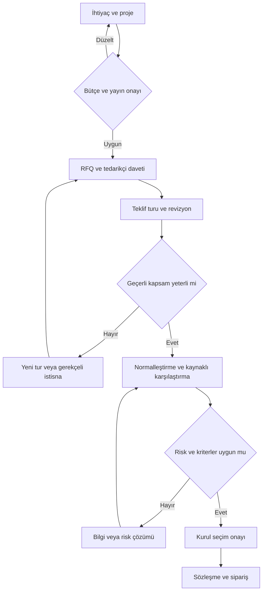
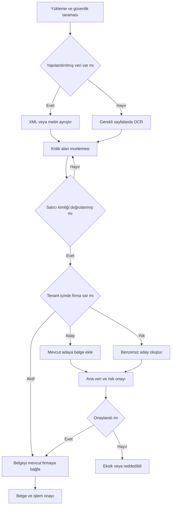
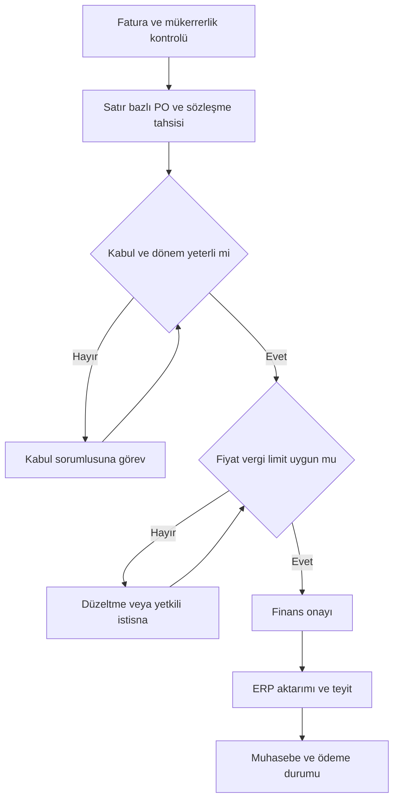
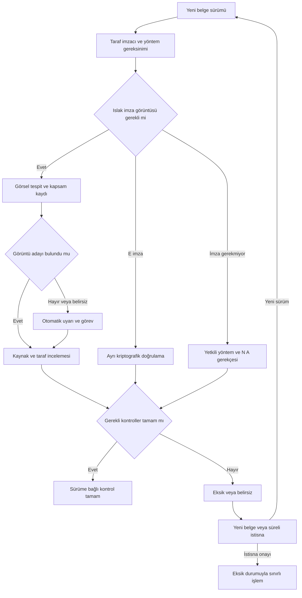
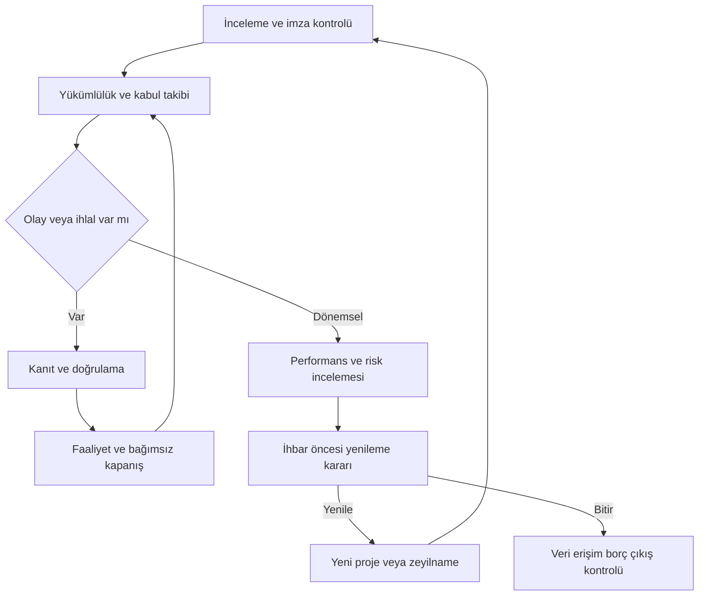
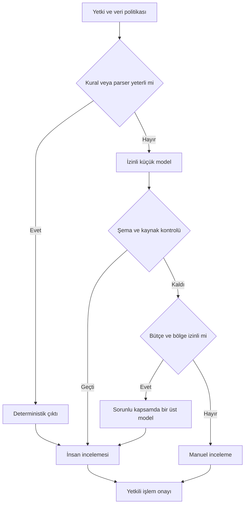

# Süreç grafikleri
Analizdeki grafikler `assets/` altında, aşağıdaki kaynaklar düzenlenebilirdir. Sade iş akışı gösterimidir, eksiksiz BPMN motor tanımı değildir. Her ok API durum geçişi ve yetki kontrolüyle eşlenir.

## Satınalma

## Belge ve firma

## Fatura

## İmza

## Sözleşme ve olay

## AI yönlendirme

